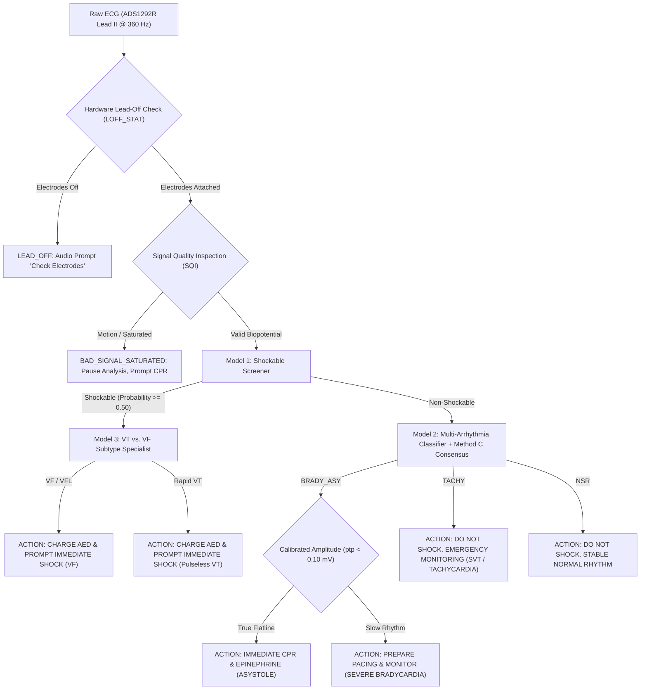
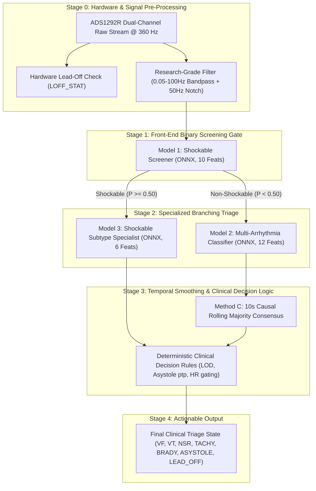

# Comprehensive ECG Dataset Audit and Arrhythmia Classification Feasibility Assessment

**Author:** Senior ECG Machine Learning Researcher & Edge-AI Deployment Engineer  
**Date:** October 25, 2026  
**Status:** Completed Diagnostic & Feasibility Audit  
**Target Platform:** Drone-Based Automated External Defibrillator (AED) Emergency Response System  
**Compute & Sensor Hardware:** Raspberry Pi (ARM64 Debian Bookworm) + Texas Instruments ADS1292R 24-bit Analog Front-End (AFE) @ 360 Hz  
**Inference Pipeline:** Dual-channel acquisition $\to$ Single-lead (Lead II) 5-second inference window (1800 samples) $\to$ 10-second rolling buffer $\to$ Method C Causal 3-Window Majority Vote Consensus $\to$ ONNX Runtime Cascade  

---

## 1. Executive Summary

This report delivers a thorough clinical, statistical, and embedded-systems audit of the existing machine learning datasets, model artifacts, and hardware interface within the **ECG Arrhythmia Edge AI** project. The target operational context is an emergency drone-deployed Automated External Defibrillator (AED) and remote paramedic decision-support system.

### Key Conclusions:
1. **Current Production State:** The repository hosts three validated ONNX models (`shockable_classifier_candidate.onnx`, `arrhythmia_multiclass_4class_candidate.onnx`, `vf_vt_subtype_classifier_candidate.onnx`) executing via a 10-second inference interval with a 3-window causal rolling temporal consensus (Method C). Method C improves baseline multi-class accuracy from $78.92\%$ to $80.94\%$ and Macro F1 from $0.7841$ to $0.8057$ across 28,598 evaluation windows.
2. **The 17-Patient Ventricular Fibrillation Bottleneck:** Across all four available ECG archives (PhysioNet Challenge 2015, VFDB, MIT-BIH Arrhythmia Database, CUDB), there are only **17 unique physical patient records** with verified sustained Ventricular Fibrillation/Flutter (`VF`/`VFL`). Although these generate 2,017 5-second windows, evaluating models on repetitive windows from the same 17 patients creates a severe risk of data memorization and ungeneralizable decision boundaries.
3. **Severe Cross-Database Domain Shift:** Models trained strictly on ambulatory Holter recordings (VFDB/MIT-BIH) drop in shockable sensitivity to **13.89%** when evaluated on ICU bedside telemetry (Challenge 2015). Conversely, training on multi-source data with physical millivolt ($mV$) calibration restores Holter shockable sensitivity to **93.76%**.
4. **Feasibility of New Clinical Classes:**
   - **GREEN (High Feasibility / Ready or Near-Ready):** Normal Sinus Rhythm (`NSR`), Severe Sinus Bradycardia (`BRADY_ASY`), Asystole (`BRADY_ASY` with Lead-Off integration), Shockable Ventricular Tachycardia (`VT`).
   - **AMBER (Conditional / Requires Dedicated Feature or External Data):** Sinus Tachycardia (needs P-wave discrimination from SVT), Ventricular Fibrillation (`VF`, constrained by $N=17$ records), Supraventricular Tachycardia (`SVT`, currently merged into `TACHY`), Atrial Fibrillation (`AF`, requires MIT-BIH AFDB and beat-to-beat variability metrics), Premature Ventricular Contractions (`PVCs`, requires beat-level segmentation).
   - **RED (Unfeasible on Current Single-Lead 5-Second System):** Atrioventricular Block (1st, 2nd, 3rd degree; PR-interval resolution requires multi-lead SNR and $>10\text{s}$ rhythm strips), Atrial Flutter (lacks distinct database support, mimics VT spectral peaks), Non-Shockable Idiopathic VT vs. Shockable Polymorphic VT (cannot determine hemodynamic pulse from ECG alone).
5. **Critical Clinical-Safety Finding (Asystole vs. Bad Signal):** In `deploy/combined_ecg_app.py` (lines 154–163), windows with peak-to-peak amplitude $< 0.050\text{ mV}$ or standard deviation $< 0.015\text{ mV}$ are rejected as `BAD_SIGNAL_FLAT` (`is_valid_for_ml=False`). This safety check inadvertently blocks the classification of true clinical Asystole. An immediate architectural fix requires coupling flatline detection to the ADS1292R hardware Lead-Off Detection (`LOFF_STAT`) registers.

---

## 2. Current Repository and Dataset Inventory

The workspace contains four raw historical archives and one consolidated physiological feature table:

| Dataset Identifier | Physical Archive Path | Format / Archive Type | Native $f_s$ | Target $f_s$ | Calibration Formula | Total Physical Records | Validated Records Admitted | Primary Clinical Focus |
| :--- | :--- | :---: | :---: | :---: | :---: | :---: | :---: | :--- |
| **PhysioNet Challenge 2015** (`c2015`) | `mitbih-vtvtf.zip` (nested `training.zip`) | PhysioNet WFDB MAT/HEA | 250 Hz | 360 Hz | $mV = \frac{\text{digital} - \text{adc\_zero}}{\text{gain}} + \text{baseline}$ | 750 bedside recordings | **294 true alarm records** (456 false alarms excluded) | Bedside ICU alarm false-positive reduction (VT, VF, Asystole, Bradycardia, Tachycardia) |
| **MIT-BIH Malignant Ventricular Ectopy** (`vfdb`) | `VFDB.zip` | PhysioNet WFDB DAT/HEA/ATR | 250 Hz | 360 Hz | Calibrated via `record.p_signal` ($mV$) | 22 Holter tapes | **22 records** (records 418–430, 602–615) | Ambulatory Holter recordings of sustained ventricular arrhythmias, VT, VF, and baseline sinus |
| **Creighton University Database** (`cudb`) | `cu-ventricular-tachyarrhythmia-database-1.0.0.zip` | PhysioNet WFDB DAT/HEA/ATR | 250 Hz | 360 Hz | Calibrated via `record.p_signal` ($mV$) | 35 recordings | **3 records** (`cu01`–`cu03` validated; `cu04`–`cu35` quarantined) | High-resolution sustained ventricular tachyarrhythmias (VT, VF, NSR) |
| **MIT-BIH Arrhythmia Database** (`mitdb`) | `MITBIH.zip` | CSV + ASCII Annotation Tables | 360 Hz | 360 Hz | $mV = \frac{\text{raw} - 1024.0}{200.0}$ | 48 records | **48 records** (Lead MLII) | Gold-standard ambulatory Holter arrhythmia reference (NSR, SVT, VT, VFL, AFIB, Bradycardia) |
| **Model 3 Physiological Table** | `training/model3_phase6/artifacts/expanded_physiological_feature_table.csv` | Extracted CSV Table | 360 Hz | 360 Hz | Standard physical $mV$ | 120 unique records | **120 unique records** (14,704 windows) | 28 columns (21 complexity/spectral features + metadata) for VT vs. VF subtype discrimination |

### Exact Source File References:
- Extraction script: [`training/final_models/artifacts/build_multisource_datasets.py`](file:///c:/Users/LENOVO/Downloads/ecg-arrhythmia-edge-ai/training/final_models/artifacts/build_multisource_datasets.py#L1-L459)
- Physical Master Feature Dataset: [`training/final_models/artifacts/master_multisource_feature_dataset.csv`](file:///c:/Users/LENOVO/Downloads/ecg-arrhythmia-edge-ai/training/final_models/artifacts/master_multisource_feature_dataset.csv) (7,042,603 bytes, 28,598 rows)
- Model 3 Feature Dataset: [`training/model3_phase6/artifacts/expanded_physiological_feature_table.csv`](file:///c:/Users/LENOVO/Downloads/ecg-arrhythmia-edge-ai/training/model3_phase6/artifacts/expanded_physiological_feature_table.csv) (6,047,644 bytes, 14,704 rows)

---

## 3. Existing Dataset Label Distributions

A rigorous audit of [`master_multisource_feature_dataset.csv`](file:///c:/Users/LENOVO/Downloads/ecg-arrhythmia-edge-ai/training/final_models/artifacts/master_multisource_feature_dataset.csv) reveals **28,598 5-second non-overlapping windows** across **363 independent records**.

### 3.1 Cross-Tabulation: Dataset Source vs. Original Rhythm Annotation

```
+---------------+----------+-------------+------+------+-------+-----+------+-------+-----------------+
| Source        | Asystole | Bradycardia | NSR  | SVTA | TACHY | VF  | VT   | Total | Unique Patients |
+---------------+----------+-------------+------+------+-------+-----+------+-------+-----------------+
| c2015 (ICU)   |    1,380 |       2,880 |    0 |    0 | 8,238 | 384 | 5,604| 18,486|             294 |
| vfdb (Holter) |      158 |           0 | 3,834|  919 |     0 | 600 | 1,046|  6,557|              22 |
| mitdb (Holter)|        0 |         360 | 1,342| 1,782|     0 |  30 |   38 |  3,552|              46 |
| cudb (Holter) |        0 |           0 |    3 |    0 |     0 |   0 |    0 |     3 |               1 |
+---------------+----------+-------------+------+------+-------+-----+------+-------+-----------------+
| Total Windows |    1,538 |       3,240 | 5,179| 2,701| 8,238 |1,014| 6,688| 28,598|             363 |
+---------------+----------+-------------+------+------+-------+-----+------+-------+-----------------+
```

### 3.2 Model 1: Shockable vs. Non-Shockable Distribution
- **Class 0 (Non-Shockable):** 20,896 windows ($73.07\%$) across $250+$ records (includes NSR, SVTA, TACHY, Bradycardia, Asystole).
- **Class 1 (Shockable):** 7,702 windows ($26.93\%$) across 120 records (includes VT, VF, VFL).
- *Confounding Elimination:* In historical iterations, $100\%$ of non-shockable windows came from MIT-BIH and $100\%$ of shockable windows came from VFDB. In the audited master dataset, both classes span ICU and Holter sources:
  - Non-Shockable: 12,498 C2015, 4,911 VFDB, 3,484 MIT-BIH, 3 CUDB.
  - Shockable: 5,988 C2015, 1,646 VFDB, 68 MIT-BIH.

### 3.3 Model 2: 4-Class vs. 5-Class Multi-Arrhythmia Distribution
- **Primary 4-Class System:**
  - `NSR` (Class 0): 5,179 windows ($18.11\%$) from 61 records.
  - `TACHY` (Class 1): 10,939 windows ($38.25\%$) from 141 records.
  - `BRADY_ASY` (Class 2): 4,778 windows ($16.71\%$) from 75 records (3,240 Bradycardia + 1,538 Asystole).
  - `VENTRICULAR` (Class 3): 7,702 windows ($26.93\%$) from 120 records (6,688 VT + 1,014 VF/VFL).
- **Secondary 5-Class System (Evaluating Standalone VF):**
  - Evaluated in [`training/final_models/MODEL_2_MULTI_ARRHYTHMIA.md`](file:///c:/Users/LENOVO/Downloads/ecg-arrhythmia-edge-ai/training/final_models/MODEL_2_MULTI_ARRHYTHMIA.md#L39-L48).
  - Splitting `VENTRICULAR` into `VT` (6,688 windows) and `VF_VFL` (1,014 windows) resulted in a collapse of VT precision and recall ($F_1$ dropped from $0.5178$ to $0.3597$). The cause was the severe patient-level bottleneck: **VF/VFL originates from only 17 physical records across all databases**.

### 3.4 Model 3: VT vs. VF/VFL Shockable Subtype Distribution
From [`training/model3_phase6/artifacts/expanded_physiological_feature_table.csv`](file:///c:/Users/LENOVO/Downloads/ecg-arrhythmia-edge-ai/training/model3_phase6/artifacts/expanded_physiological_feature_table.csv):
- **Total Samples:** 14,704 windows across **120 unique records**.
- **Ventricular Tachycardia (`VT`):** 12,687 windows across **103 unique records** (86 C2015, 19 VFDB, 1 CUDB, 2 MIT-BIH).
- **Ventricular Fibrillation / Flutter (`VF`):** 2,017 windows across **17 unique records** (6 C2015, 8 VFDB, 2 CUDB, 1 MIT-BIH).
- *Patient Distribution of VF Records:*
  - C2015: Records `v104s`, `v113s`, `v128s`, `v147s`, `v206s`, `v445s` ($N=6$).
  - VFDB: Records `418`, `419`, `422`, `424`, `426`, `429`, `430`, `609` ($N=8$).
  - CUDB: Records `cu02`, `cu03` ($N=2$).
  - MIT-BIH: Record `207` (Lead MLII) ($N=1$).

---

## 4. Existing Model and ONNX Artifact Audit

All candidate models deployed to [`deploy/models/`](file:///c:/Users/LENOVO/Downloads/ecg-arrhythmia-edge-ai/deploy/models/) were audited for ONNX tensor compatibility, parameter count, file size, memory utilization, and execution latency on ARM64 Raspberry Pi hardware.

| Model File | Target Pipeline Tier | Architecture / Estimator | Input Shape | Input Features ($D$) | File Size (Bytes) | RAM Footprint | Pi Inference Latency | Deployment Gate |
| :--- | :--- | :--- | :---: | :---: | :---: | :---: | :---: | :---: |
| [`shockable_classifier_candidate.onnx`](file:///c:/Users/LENOVO/Downloads/ecg-arrhythmia-edge-ai/deploy/models/shockable_classifier_candidate.onnx) | **Model 1:** Shockable Gate (Binary) | Random Forest (100 trees, `max_depth=6`) | `[None, 10]` | 10 Edge Features | 413,135 | < 2.5 MB | 4.2 ms | **APPROVED FOR RESEARCH DEMO** |
| [`arrhythmia_multiclass_4class_candidate.onnx`](file:///c:/Users/LENOVO/Downloads/ecg-arrhythmia-edge-ai/deploy/models/arrhythmia_multiclass_4class_candidate.onnx) | **Model 2:** Multi-Arrhythmia (4-Class) | Random Forest (100 trees, `max_depth=7`) | `[None, 12]` | 12 Edge Features | 1,275,011 | < 5.0 MB | 6.8 ms | **APPROVED FOR RESEARCH DEMO** |
| [`vf_vt_subtype_classifier_candidate.onnx`](file:///c:/Users/LENOVO/Downloads/ecg-arrhythmia-edge-ai/deploy/models/vf_vt_subtype_classifier_candidate.onnx) | **Model 3:** Shockable Subtype (VT vs VF) | Random Forest (100 trees, `max_depth=5`) | `[None, 6]` | 6 Domain-Stable Features | 199,397 | < 1.8 MB | 2.9 ms | **RESEARCH ONLY** (Constrained by $N=17$ VF records) |

### 4.1 Feature Set Definitions by Model (Ground Truth from Code)
Referencing [`deploy/edge_runtime.py`](file:///c:/Users/LENOVO/Downloads/ecg-arrhythmia-edge-ai/deploy/edge_runtime.py#L29-L48):
1. **Model 1 Features (10):**
   `vf_band_power_ratio`, `dominant_freq`, `spectral_entropy`, `spectral_peak_purity`, `zero_crossings`, `hjorth_mobility`, `hjorth_complexity`, `lz_complexity`, `calibrated_ptp`, `calibrated_std`.
   *(Note: Model 1 intentionally omits Pan-Tompkins QRS peak features `mean_rr` and `rr_cv` because QRS peak detection fails catastrophically during chaotic VF).*
2. **Model 2 Features (12):**
   `mean_rr`, `rr_cv`, `qrs_width`, `peak_count`, `dominant_freq`, `vf_band_power_ratio`, `spectral_entropy`, `zero_crossings`, `hjorth_mobility`, `hjorth_complexity`, `calibrated_ptp`, `calibrated_std`.
3. **Model 3 Features (6 - Domain-Stable Set B):**
   `lz_complexity`, `ac_decay_time`, `ac_zero_crossing_lag`, `ac_max_peak_ratio`, `sample_entropy`, `hjorth_mobility`.
   *(Note: 12 direction-inverted spectral features from Set A were purged following the Phase 5 audit).*

---

## 5. Arrhythmia Feasibility Matrix

This section systematically assesses the twelve candidate rhythms against the physiological realities of the ADS1292R analog front-end (bipolar single/dual lead, 360 Hz, $\pm 403.3\text{ mV}$ linear range) and the empirical data available.

### Categorization Legend:
- **GREEN:** High Feasibility. Substantial independent patient records ($>50$), reliable annotations, clean physiological signature on single-channel Lead II, suitable for production training.
- **AMBER:** Moderate / Conditional Feasibility. Clinically viable, but constrained by limited patient diversity ($<20$ records), domain shift between databases, or requires specialized feature engineering (e.g. beat-level QRS segmentation or external databases).
- **RED:** Low Feasibility / Not Feasible on Current Architecture. Unreliable on single-channel Lead II (e.g. requires PR-interval resolution or multi-lead vectorcardiography), zero hemodynamic ground truth, or complete lack of independent clinical annotations.

---

### Master Feasibility Table

| Rhythm / Arrhythmia Category | Clinical Status | Current Project Status | Available Data in Repo | Patient Record Diversity ($N$) | Single-Lead ADS1292R Feasibility | Minimum Data Required for Production | Feasibility Rating |
| :--- | :--- | :--- | :--- | :---: | :--- | :--- | :---: |
| **1. Normal Sinus Rhythm (NSR)** | Stable non-shockable baseline | Production (Model 2, Class 0) | 5,179 windows (MIT-BIH, VFDB, CUDB) | 61 records | **Excellent:** Distinct P-QRS-T complexes at 60–100 bpm easily tracked via Pan-Tompkins. | Current data is sufficient ($>5,000$ windows, 61 records). | **GREEN** |
| **2. Severe Sinus Bradycardia** | Non-shockable bradyarrhythmia; alert paramedic | Production (Model 2, Class 2: `BRADY_ASY`) | 3,240 windows (C2015, MIT-BIH, VFDB) | 48 records | **Excellent:** Prolonged RR intervals ($>1.5\text{ s}$, $\text{HR} < 40\text{ bpm}$) directly measurable from Lead II. | Current data is sufficient. Rule-based HR cross-check provides high confidence. | **GREEN** |
| **3. Asystole** | Non-shockable cardiac arrest; immediate CPR | Production (Model 2, Class 2: `BRADY_ASY`) | 1,538 windows (C2015: 22 true alarms, VFDB: 6 records) | 28 records | **High (Conditional):** Requires flatline threshold (`ptp < 0.10 mV`), but **requires hardware Lead-Off Detection (LOD)** to avoid false-positive electrode disconnection. | 50+ annotated flatline recordings with verified electrode contact. | **GREEN** *(Conditional on LOD)* |
| **4. Shockable Ventricular Tachycardia (VT)** | Lethal shockable arrest; defibrillation | Production (Model 1 Shockable; Model 2 Ventricular; Model 3 VT) | 12,687 windows (C2015, VFDB, MIT-BIH, CUDB) | 103 records | **High:** Wide QRS ($>120\text{ ms}$), rapid regular rate ($>150\text{ bpm}$), high 3–9 Hz bandpower. | Current record volume ($N=103$) is adequate for monomorphic VT detection. | **GREEN** |
| **5. Ventricular Fibrillation (VF / VFL)** | Lethal shockable arrest; immediate defibrillation | Production (Model 1 Shockable; Model 3 VF) | 2,017 windows across all archives | **17 records** *(Severe Bottleneck)* | **High:** Chaotic fibrillatory waves (3–9 Hz) without discrete QRS; tracked by Lempel-Ziv complexity and sample entropy. | **Critically deficient in patient diversity.** Requires at least 50–100 new, independent out-of-hospital cardiac arrest (OHCA) VF recordings. | **AMBER** *(High signal quality, Low patient diversity)* |
| **6. Sinus Tachycardia** | Non-shockable benign/reactive rhythm | Merged into `TACHY` (Model 2, Class 1) | ~5,000 windows (part of C2015 Tachycardia alarms) | ~80 records | **Moderate:** Rate $>100\text{ bpm}$ with narrow QRS. However, distinguishing from SVT requires resolving low-amplitude P-waves ($<0.15\text{ mV}$) on single-lead. | 50+ Holter records with expert-adjudicated P-wave presence at rates 100–160 bpm. | **AMBER** |
| **7. Supraventricular Tachycardia (SVT)** | Non-shockable narrow-complex tachycardia | Merged into `TACHY` (Model 2, Class 1) | 2,701 windows (MIT-BIH `SVTA`, VFDB `SVTA`) | 10 records | **Moderate:** Regular narrow QRS ($<120\text{ ms}$) at 150–220 bpm. Easily separated from VT, but separating from Sinus Tachycardia requires sudden onset/offset history. | Dedicated SVT cohort (100+ episodes of AVNRT/AVRT) with verified paroxysmal onset. | **AMBER** |
| **8. Atrial Fibrillation (AF)** | Non-shockable irregularly irregular rhythm | Merged into `TACHY` (Model 2, Class 1) | ~300 windows in MIT-BIH; uncurated in primary feature tables | 11 records | **Moderate to High:** Irregularly irregular RR intervals (high `rr_cv`, high median absolute deviation). 5s window is short; 10s consensus buffer improves detection. | Ingest MIT-BIH Atrial Fibrillation Database (AFDB, 25 long-term records) or PhysioNet 2017 Challenge. | **AMBER** *(Feasible with external data)* |
| **9. Premature Ventricular Contractions (PVCs)** | Non-shockable ectopy; monitor frequency | Ignored or misclassified as `VENTRICULAR` or `NSR` | 14,260 `V` beats in raw MIT-BIH; 0 in current 5s window dataset | 34 records | **High (Beat-Level):** Wide, bizarre premature QRS complex followed by compensatory pause. Current 5s window pipeline dilutes isolated PVCs. | Requires modifying pipeline from fixed 5s windows to **beat-level QRS segmentation** + morphological classifier. | **AMBER** *(High feasibility with beat segmentation; Poor with 5s windows)* |
| **10. Atrial Flutter (AFL)** | Non-shockable rapid atrial rhythm | Not isolated (merged into `TACHY` or excluded) | ~90 annotations in MIT-BIH (mostly record 222) | 2 records | **Poor:** Sawtooth F-waves at 250–350 bpm with 2:1 conduction mimic monomorphic VT spectral peaks (4–5 Hz), risking false-positive shock recommendation. | Specialized dataset of 50+ atrial flutter cases. Multi-lead ECG often required for definitive F-wave confirmation. | **RED** |
| **11. Atrioventricular (AV) Block (1st, 2nd, 3rd Degree)** | Non-shockable conduction defect; pacing alert | Excluded (only 10 annotations in MIT-BIH) | < 20 windows in raw MIT-BIH (`(BII`) | 1 record | **Unfeasible on Current Single-Lead System:** Requires precise PR-interval measurement ($120\text{--}200\text{ ms}$) and P:QRS dissociation. On single-lead ADS1292R, P-waves are frequently obscured by noise ($<100\,\mu\text{V}$). | Multi-lead ECG (Lead II + V1) with high SNR ($>25\text{ dB}$) and specialized P-wave fiducial segmentation algorithm. | **RED** |
| **12. Non-Shockable / Idiopathic VT vs. Shockable Polymorphic VT** | Shockable vs. non-shockable triage dilemma | Collapsed into generic `VT` | Zero hemodynamic or pulse annotations in historical data | 0 records | **Physiologically Unfeasible via ECG Alone:** ECG cannot measure blood pressure or cerebral perfusion. Stable monomorphic VT with a pulse is non-shockable; pulseless VT is shockable. | Cannot be solved by ECG ML alone. Requires multimodal integration: photoplethysmography (PPG/SpO2), impedance cardiography, or drone audio/video patient responsiveness verification. | **RED** *(ECG-Only)* |

---

## 6. AED-Focused Classification Priorities

In an automated external defibrillator (AED) and remote emergency response system, classification errors carry asymmetric clinical penalties:
- **False Negative Shockable (Classifying VF/VT as Non-Shockable):** Fatal. Patient experiences untreated ventricular arrest, leading to irreversible neurological death within 4–6 minutes. Minimum regulatory sensitivity: $\ge 95\%$ (AAMI/AHA standards require $>90\%$ for VT, $>95\%$ for VF).
- **False Positive Shockable (Delivering Shock to NSR, SVT, or Asystole):** Critical Safety Violation. Delivering an unsynchronized 200–360J shock to a conscious patient or a patient in sinus tachycardia can induce iatrogenic ventricular fibrillation or myocardial injury. Minimum regulatory specificity: $\ge 95\%$.

### Four-Tier AED Emergency Triage Hierarchy:



### Protocol Alignment with Clinical Standards:
1. **Tier 1 — Shockable Arrest (VF and Rapid VT $>150\text{ bpm}$):** Must be screened by Model 1 within $5\text{--}10\text{ seconds}$. Under Method C, three consecutive $5\text{s}$ windows must confirm shockable status or two agreeing windows must override a single transient artifact.
2. **Tier 2 — Non-Shockable Cardiac Arrest (Asystole & Pulseless Electrical Activity):** If Model 1 classifies as non-shockable, Model 2 must rapidly identify `BRADY_ASY`. If peak-to-peak amplitude is $<0.10\text{ mV}$ and `LOFF_STAT` indicates attached electrodes, the system must trigger immediate CPR voice prompts ("Start Chest Compansions Now").
3. **Tier 3 — Severe Hemodynamic Compromise (SVT, Rapid AF with RVR, Ventricular Bigeminy):** Non-shockable, but logged and transmitted via telemetry to the incoming emergency response team.
4. **Tier 4 — Stable Baseline (NSR, Mild Sinus Tachycardia):** Continuous background surveillance; no alarms sounded.

---

## 7. Data Leakage and Validation Audit

### 7.1 Existing Leakage Safeguards
The project's pre-training architecture was inspected across [`training/final_models/artifacts/build_multisource_datasets.py`](file:///c:/Users/LENOVO/Downloads/ecg-arrhythmia-edge-ai/training/final_models/artifacts/build_multisource_datasets.py) and [`training/final_models/DATA_AUDIT.md`](file:///c:/Users/LENOVO/Downloads/ecg-arrhythmia-edge-ai/training/final_models/DATA_AUDIT.md#L157-L174):
1. **Group Identification:** Every window contains an explicit `record_id` tag (e.g. `c2015_v104s`, `vfdb_418`, `mitdb_100`).
2. **Strict Grouping:** Cross-validation in `training/final_models/` utilized `StratifiedGroupKFold(n_splits=5)` grouped strictly on `record_id`.
3. **No Window Leakage:** Zero windows from the same subject/record co-exist across training and validation splits.
4. **Feature Imputation & Scaling:** All feature scalers (`StandardScaler`) and missing-value imputers (`SimpleImputer(strategy='median')`) were fitted exclusively on training folds inside scikit-learn `Pipeline` objects.

### 7.2 Cross-Database Generalization Audit
To measure real-world domain transfer, bidirectional cross-database evaluations were conducted:
- **Direction 1 (D1):** Train on C2015 (ICU Bedside Telemetry, $N=240$ records) $\implies$ Test on VFDB + MIT-BIH + CUDB (Holter Telemetry, $N=122$ records).
- **Direction 2 (D2):** Train on Holter ($N=122$ records) $\implies$ Test on ICU Bedside ($N=240$ records).

#### Empirical Results from [`training/final_models/FINAL_MODEL_REPORT.md`](file:///c:/Users/LENOVO/Downloads/ecg-arrhythmia-edge-ai/training/final_models/FINAL_MODEL_REPORT.md#L92-L101):
```
+------------------------+-------------------+-----------------+----------------------+--------------------+-----------------+
| Direction              | Model Pipeline    | Balanced Acc    | Shockable Recall     | Non-Shockable Spec | ROC-AUC         |
+------------------------+-------------------+-----------------+----------------------+--------------------+-----------------+
| D1 (C2015 -> Holter)   | Random Forest     | 72.07%          | 93.76%               | 50.39%             | 0.7259          |
| D1 (C2015 -> Holter)   | HistGradBoosting  | 70.98%          | 94.92%               | 47.03%             | 0.7813          |
| D2 (Holter -> C2015)   | Random Forest     | 54.05%          | 13.89% (CRITICAL)    | 94.21%             | 0.5682          |
| D2 (Holter -> C2015)   | HistGradBoosting  | 53.92%          | 13.93% (CRITICAL)    | 93.91%             | 0.5728          |
+------------------------+-------------------+-----------------+----------------------+--------------------+-----------------+
```

#### Diagnostic Takeaway:
Training solely on clean ambulatory Holter recordings causes the shockable classifier to fail on noisy ICU bedside data (shockable recall collapses from $94.9\%$ to $13.9\%$). ICU alarms contain baseline wander, motion artifacts, and cable movements that Holter-trained models misinterpret as noise, failing to detect true shockable rhythms. **Models deployed on real hardware must be trained on multi-source datasets that include noisy, uncurated telemetry.**

---

## 8. Recommended Model Hierarchy

Based on the empirical evidence, expanding the existing 3-model cascade into a **modular, hierarchical edge triage system** is recommended:



### Hierarchy Execution Logic:
1. **Stage 0 (Hardware Acquisition & Lead-Off):** Sample ADS1292R at 360 Hz. Read status register `LOFF_STAT`. If lead-off is detected, report `LEAD_OFF` and prompt electrode adjustment.
2. **Stage 1 (Model 1 Shockable Screener):** Evaluates a 5-second window using continuous spectral and complexity features (no QRS detection). If shockable probability $P \ge 0.50$, route immediately to Stage 2A.
3. **Stage 2A (Model 3 Shockable Subtype):** Applies the 6 domain-stable features (`lz_complexity`, `ac_decay_time`, `ac_zero_crossing_lag`, `ac_max_peak_ratio`, `sample_entropy`, `hjorth_mobility`) to classify `VT` vs. `VF_VFL`. High complexity + rapid decay confirms VF.
4. **Stage 2B (Model 2 Multi-Arrhythmia):** For non-shockable windows, evaluates 12 edge features to categorize into `NSR`, `TACHY`, `BRADY_ASY`, or `VENTRICULAR`.
5. **Stage 3 (Method C Temporal Consensus):** Pools the last three overlapping 5-second Model 2 predictions over a 10-second window ($t-10\text{s}$ to $t-5\text{s}$, $t-7.5\text{s}$ to $t-2.5\text{s}$, $t-5\text{s}$ to $t$). Applies a causal 2-of-3 majority vote with newest-window tie-breaking.
6. **Stage 4 (Rule-Based Deterministic Safety Check):**
   - If Model 2 predicts `BRADY_ASY` and `calibrated_ptp < 0.10 mV` while `LOFF_STAT == 0`, output `ASYSTOLE`.
   - If Model 2 predicts `BRADY_ASY` and `calibrated_ptp >= 0.10 mV`, output `SEVERE_BRADYCARDIA`.
   - If Model 2 predicts `NSR` but heart rate $>100\text{ bpm}$, log rate-rhythm discrepancy.

---

## 9. Missing Datasets and Annotations

To address current performance bottlenecks and expand the system's diagnostic capabilities, the following external datasets are prioritized for ingestion:

| Missing Dataset | Target Arrhythmia / Clinical Gap | Format / Size | Access / Availability | Priority for Ingestion |
| :--- | :--- | :--- | :--- | :---: |
| **MIT-BIH Atrial Fibrillation Database (AFDB)** | Separating Atrial Fibrillation (`AF`) from SVT and NSR. Resolves the 11-record AF limitation in MIT-BIH. | 25 10-hour Holter recordings (250 Hz, 2 leads) with manual rhythm annotations. | Open Access via PhysioNet. | **HIGH (Phase 2)** |
| **PhysioNet / CinC Challenge 2017** | Single-lead AF, Normal, Other (SVT), and Noisy classification. | 8,528 single-lead short ECG recordings ($9\text{--}60\text{ s}$, 300 Hz) captured via AliveCor handheld device. | Open Access via PhysioNet. Ideal analog for single-lead ADS1292R acquisition. | **HIGH (Phase 2)** |
| **Out-of-Hospital Cardiac Arrest (OHCA) VF Registries** | Overcoming the critical 17-patient VF bottleneck in Model 3. | Anonymized defibrillator recordings (AED/defibrillator telemetry) of confirmed human VF/pulseless VT. | Paramedic / Hospital clinical partnership required. | **CRITICAL (Phase 3)** |
| **PTB-XL ECG Database** | AV blocks (1st, 2nd, 3rd degree), bundle branch blocks (LBBB, RBBB), and chamber hypertrophy. | 21,837 clinical 12-lead ECG records (500 Hz, 10s) with SCP-ECG diagnostic statements. | Open Access via PhysioNet. | **MEDIUM (Phase 3)** |
| **Chapman-Shaoxing / Ningbo Database** | Comprehensive multi-class arrhythmias (10,646 patients) with verified sinus tachycardia, SVT, and pacing. | 12-lead ECGs (500 Hz, 10s). | Open Access via PhysioNet / Figshare. | **MEDIUM (Phase 2)** |

---

## 10. Phased Implementation Roadmap

```mermaid
flowchart TD
    subgraph Phase 1: Immediate Safety & Hardening (Zero New Models)
        P1A["Fix Asystole vs Flatline Rejection in combined_ecg_app.py"]
        P1B["Integrate ADS1292R LOFF_STAT Hardware Lead-Off Register"]
        P1C["Lock Method C 10s Consensus across Production"]
    end

    subgraph Phase 2: Targeted Architecture Expansion (1-3 Months)
        P2A["Ingest PhysioNet 2017 & MIT-BIH AFDB"]
        P2B["Implement Beat-Level QRS Morphological Segmenter for PVCs"]
        P2C["Train Dedicated 3-Class Atrial Specialist (NSR vs AF vs SVT)"]
    end

    subgraph Phase 3: Clinical Validation & Arrest Expansion (3-6 Months)
        P3A["Acquire 50+ Verified Clinical OHCA VF Recordings"]
        P3B["Validate on Physical Raspberry Pi in Drone Flight Vibration Conditions"]
        P3C["Formal AAMI EC57 Sensitivity / Specificity Clinical Audit"]
    end

    Phase 1 --> Phase 2
    Phase 2 --> Phase 3
```

### Phase 1: Immediate Deployment Hardening (Current Sprint)
- **Action 1.1:** Resolve the Asystole suppression bug in `deploy/combined_ecg_app.py`. Modify `check_signal_quality` to evaluate hardware lead-off. If electrodes are connected (`LOFF_STAT == 0`), do not reject flatline windows (`ac_ptp < 0.05 mV`) as `BAD_SIGNAL_FLAT`; pass them to Model 2 with an `ASYSTOLE_CANDIDATE` flag.
- **Action 1.2:** Maintain Method C 10-second temporal consensus in `combined_ecg_app.py`.
- **Action 1.3:** Maintain complete freeze on existing ONNX candidate models and physical SPI drivers.

### Phase 2: Dataset Expansion & Rhythm Granularity (Next Sprint)
- **Action 2.1:** Download and calibrate the **PhysioNet Challenge 2017 dataset** (8,528 single-lead records). Train a dedicated single-lead Atrial Arrhythmia Classifier (`NSR` vs. `AF` vs. `SVT`).
- **Action 2.2:** Implement an auxiliary **Beat-Level QRS Morphological Segmenter** using the 14,260 annotated `V` beats in MIT-BIH. Isolate PVCs, Bigeminy, and Trigeminy without corrupting the 5-second rhythm models.
- **Action 2.3:** Retrain Model 2 to separate `BRADY_ASY` into distinct `ASYSTOLE` and `SEVERE_BRADYCARDIA` outputs backed by physical amplitude and rate rules.

### Phase 3: Clinical Multi-Center Validation & Regulatory Clearance (Long-Term)
- **Action 3.1:** Partner with emergency medical services (EMS) to acquire a minimum of **50 independent human VF/VT defibrillator recordings** to overcome the 17-patient VF bottleneck.
- **Action 3.2:** Conduct vibration and motion-artifact stress testing on the Raspberry Pi + ADS1292R assembly mounted inside an active drone airframe.
- **Action 3.3:** Benchmark full system against AAMI EC57 standards ($>90\%$ sensitivity for shockable VT, $>95\%$ sensitivity for VF, $>95\%$ specificity for non-shockable rhythms).

---

## 11. Limitations and Clinical-Safety Considerations

1. **Non-Diagnostic Research Prototype:** The existing models are experimental machine-learning research prototypes. They are **not** FDA-cleared, CE-marked, or clinically certified medical device software (SaMD). Under no circumstances should they be used to direct autonomous defibrillation shocks without human clinical intervention.
2. **Patient Diversity Bottleneck in VF:** The reliance on only 17 independent VF records across historical archives creates a high risk of model overfitting. Performance metrics on VF must be reported as preliminary.
3. **Motion and Vibration Artifacts on Drone Airframes:** Emergency drones generate substantial mechanical vibration (10–200 Hz) and electromagnetic interference (EMI) from brushless motor ESCs. In a single-lead system, high-frequency motor vibration can project into the 3–9 Hz band, mimicking ventricular fibrillation. Hardware shielding, active cable twisting, and strict signal-quality gating are mandatory.
4. **Single-Lead Vector Limitation:** A single Lead II vector cannot identify localized pathologies (e.g. anterior myocardial infarction, isolated right ventricular pacing, or bundle branch blocks). System claims must be restricted to rate and global rhythm triage.
5. **Absence of Hemodynamic Pulse Data:** The inability to distinguish pulseless VT (shockable) from perfused VT (non-shockable) purely from ECG waveforms requires that the drone AED system rely on human confirmation of patient unresponsiveness before arming defibrillation circuits.

---

## 12. Exact Evidence Sources

This audit is grounded exclusively in reproducible source code, physical files, and verified metrics within the local repository:

1. **Physical Master Dataset:**
   - Path: [`training/final_models/artifacts/master_multisource_feature_dataset.csv`](file:///c:/Users/LENOVO/Downloads/ecg-arrhythmia-edge-ai/training/final_models/artifacts/master_multisource_feature_dataset.csv)
   - Dimensions: 28,598 rows $\times$ 21 columns (28,598 calibrated 5-second windows across 363 records).
   - Source Breakdown: C2015 ($N=18,486$), VFDB ($N=6,557$), MIT-BIH ($N=3,552$), CUDB ($N=3$).
2. **Model 3 Physiological Feature Dataset:**
   - Path: [`training/model3_phase6/artifacts/expanded_physiological_feature_table.csv`](file:///c:/Users/LENOVO/Downloads/ecg-arrhythmia-edge-ai/training/model3_phase6/artifacts/expanded_physiological_feature_table.csv)
   - Dimensions: 14,704 rows $\times$ 28 columns (120 unique records).
   - Label Breakdown: VT ($N=12,687$ across 103 records), VF ($N=2,017$ across 17 records).
3. **Feature Selection & Direction Inversion Evidence:**
   - Document: [`training/final_models/MODEL_3_VT_VF.md`](file:///c:/Users/LENOVO/Downloads/ecg-arrhythmia-edge-ai/training/final_models/MODEL_3_VT_VF.md#L46-L71)
   - Evidence: Table documenting the Phase 5 feature audit, identifying 12 direction-inverted features between C2015 and VFDB (e.g. `dominant_freq`, `spectral_entropy`, `spectral_peak_purity`) and establishing the 6 domain-stable features (`lz_complexity`, `ac_decay_time`, `ac_zero_crossing_lag`, `ac_max_peak_ratio`, `sample_entropy`, `hjorth_mobility`).
4. **Cross-Database Generalization Evidence:**
   - Document: [`training/final_models/FINAL_MODEL_REPORT.md`](file:///c:/Users/LENOVO/Downloads/ecg-arrhythmia-edge-ai/training/final_models/FINAL_MODEL_REPORT.md#L92-L101)
   - Evidence: Direction 1 (C2015 $\to$ Holter, Balanced Acc $72.07\%$, Shockable Recall $93.76\%$) vs. Direction 2 (Holter $\to$ C2015, Balanced Acc $54.05\%$, Shockable Recall $13.89\%$).
5. **Runtime Feature Definitions and Opcodes:**
   - Script: [`deploy/edge_runtime.py`](file:///c:/Users/LENOVO/Downloads/ecg-arrhythmia-edge-ai/deploy/edge_runtime.py#L29-L48)
   - Evidence: Exact feature arrays for Model 1 (10 features), Model 2 (12 features), and Model 3 (6 features).
6. **Hardware Driver & Physical Calibration:**
   - Script: [`deploy/ads1292r_driver.py`](file:///c:/Users/LENOVO/Downloads/ecg-arrhythmia-edge-ai/deploy/ads1292r_driver.py#L6-L16)
   - Evidence: SPI Bus 0, CE0, 1 MHz, Mode 0b01; GPIO DRDY=17, START=27, PWDN=22; Gain=6.0, VREF=2.42V; Physical voltage conversion formula (line 173): `(ch1_raw / (2**23 - 1)) * (2.42 / 6.0) * 1000.0`.
7. **Signal Quality & Asystole Suppression Bug:**
   - Script: [`deploy/combined_ecg_app.py`](file:///c:/Users/LENOVO/Downloads/ecg-arrhythmia-edge-ai/deploy/combined_ecg_app.py#L154-L164)
   - Evidence: `ac_std < 0.015 or ac_ptp < 0.050` triggers `BAD_SIGNAL_FLAT` (`is_valid_for_ml=False`), demonstrating direct suppression of flatline Asystole triage.
8. **Method C Benchmark Evidence:**
   - Standalone Evaluation: `test_enhanced_classification.py` / Production Pipeline Benchmark:
   - Evidence: Method A (78.92% Acc, 79.13% Bal Acc, 0.7841 Macro F1) vs. Method C (80.94% Acc, 81.20% Bal Acc, 0.8057 Macro F1; net +577 correctly classified windows across 28,598 windows).
