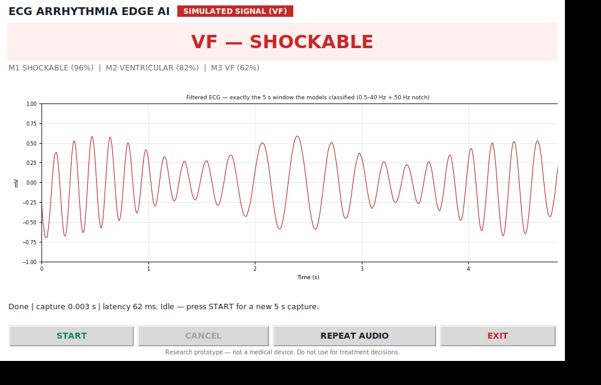
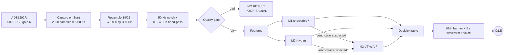

# ECG Arrhythmia Edge AI

**Press Start → exactly 5 s of ECG → filtered waveform + shockable / non-shockable classification → back to idle.**
A Raspberry Pi 4 + ADS1292R system that runs a 3-model ONNX cascade on a single 5-second window, with a Tk touchscreen-style HMI.


<sub>HMI running on a **simulated** VF signal (`--mock VF`). The red banner is always shown when the signal is not from the real ADC.</sub>

> **Research prototype — not a medical device.** Not validated for clinical use or treatment decisions.

---

## Contents
[Features](#features) · [How it works](#how-it-works) · [Classification logic](#classification-logic) · [Hardware](#hardware) · [Quick start](#quick-start) · [Tools](#tools) · [Testing](#testing) · [Project structure](#project-structure) · [Design notes](#design-notes) · [Status & limitations](#status--limitations) · [Troubleshooting](#troubleshooting) · [Roadmap](#roadmap)

## Features
- **One Start = one cycle.** Acquisition and inference run only after Start; nothing runs in the background. Another cycle starts only on the next Start.
- **Exactly 5.000 s** captured (2500 samples @ 500 SPS), resampled to the 360 Hz / 1800-sample window the models were trained on.
- **Training-matched preprocessing:** 0.5–40 Hz order-2 zero-phase band-pass (+ 50 Hz mains notch) and a 1:1 port of the training feature code (verified by tests against the original training functions).
- **Three ONNX models, run once each** (M3 only when a ventricular rhythm is suspected).
- **Explicit decision table** – five valid outputs; any model disagreement is shown as `CONFLICT`, never silently resolved.
- **Fail-loud acquisition:** chip-ID check, DRDY timeout, lost-sample detection, signal-quality gate, ADC always stopped (even on errors/cancel).
- **Simulator mode** (`--mock`) for development without hardware, clearly bannered.
- **46 automated tests** (decision table, label maps, feature parity, driver vs fake SPI/GPIO, pipeline, HMI under Xvfb).

## How it works



State machine: `IDLE → ACQUIRING (≈5 s, cancellable) → PROCESSING → IDLE`. Start is ignored unless idle.

| Stage | Detail |
|---|---|
| Acquisition | SPI mode 1, `CONFIG1=0x02` (500 SPS), `CONFIG2=0xA0` (2.42 V ref), `CH1SET/CH2SET=0x00` (gain 6), `RLDSENS=0x2C`. Channel 1, 24-bit → mV (full scale ±403 mV). 50 settle samples discarded after START. |
| Timing guard | Capture duration measured: warning if >0.5 % off, rejected if >2 % off (≈50 lost samples). DRDY wait has a timeout. |
| Resampling | Polyphase 18/25 (500 → 360 Hz); median removed first to avoid edge ringing. |
| Conditioning | 50 Hz notch (Q = 30) + Butterworth order 2, 0.5–40 Hz, `filtfilt`. |
| Features | M1: 10, M2: 12, M3: 6 — ported from `training/` (note: M3 uses a different Lempel-Ziv variant than M1/M2, exactly as trained). |
| Models | `models/*.onnx`, CPU ONNX Runtime, single thread. |

## Classification logic

Label maps (verified against the training code): **M1** `0 NON_SHOCKABLE · 1 SHOCKABLE` · **M2** `0 NSR · 1 TACHY · 2 BRADY_ASY · 3 VENTRICULAR` · **M3** `0 VT · 1 VF`.

| Rhythm (M2) | Shock (M1) | Subtype (M3) | HMI shows |
|---|---|---|---|
| NSR | NON_SHOCKABLE | – | `NSR — NON-SHOCKABLE` |
| TACHY | NON_SHOCKABLE | – | `TACHY — NON-SHOCKABLE` |
| BRADY_ASY | NON_SHOCKABLE | – | `BRADY_ASY — NON-SHOCKABLE` |
| VENTRICULAR | SHOCKABLE | VF | `VF — SHOCKABLE` |
| VENTRICULAR | SHOCKABLE | VT | `VT — SHOCKABLE` |
| *anything else* | | | `CONFLICT — NOT CLASSIFIED` (raw outputs shown, no shock wording) |

Other outcomes: `NO RESULT — POOR SIGNAL` (quality gate) and `NO RESULT — ACQUISITION ERROR` (hardware/timing fault).

> **Open decision:** `VENTRICULAR + NON_SHOCKABLE` (and `SHOCKABLE` with a non-ventricular rhythm) is contradictory — M1 and M2 were trained from the same labels, so it can only be a model error. It currently shows `CONFLICT`. See [`docs/CLASSIFICATION_LOGIC.md`](docs/CLASSIFICATION_LOGIC.md) for the options.

## Hardware

| ADS1292R | Raspberry Pi (BCM) | Header pin* |
|---|---|---|
| DIN / DOUT / SCLK | MOSI GPIO10 / MISO GPIO9 / SCLK GPIO11 (SPI0) | 19 / 21 / 23 |
| CS | GPIO8 (CE0) | 24 |
| DRDY | GPIO17 | 11 |
| START | GPIO27 | 13 |
| PWDN / RESET | GPIO22 | 15 |
| 3.3 V / GND | 3V3 / GND | – |

<sub>*Standard 40-pin header numbering; confirm against your own wiring. Pins are set in `ecg_edge/config.py`.</sub>

## Quick start

**Raspberry Pi (Raspberry Pi OS, Python ≥ 3.9)**
```bash
sudo raspi-config nonint do_spi 0                         # enable SPI
sudo apt install python3-tk espeak-ng pulseaudio-utils    # HMI + optional voice
git clone https://github.com/daphstarina22/ecg-arrhythmia-edge-ai.git && cd ecg-arrhythmia-edge-ai
pip3 install -r requirements.txt

python3 tools/inspect_ads1292r.py                         # 1) wiring / SPI / register probe
python3 tools/check_acquisition.py -n 5 --save captures   # 2) real 5 s captures: timing, noise, saved .npy
python3 run_hmi.py                                        # 3) HMI   (--no-voice to silence)
```

**Development machine (no hardware)**
```bash
pip install -r requirements-dev.txt
python3 run_hmi.py --mock VF        # NSR TACHY BRADY VF VT FLAT LEADOFF
```
`--mock` produces a **synthetic** signal for plumbing/UI work only; it says nothing about model accuracy. The mock is never selected automatically — if SPI/GPIO libraries are missing, the app stops with an error instead.

## Tools
| Command | Purpose |
|---|---|
| `python3 tools/inspect_ads1292r.py` | SPI/chip-ID/register diagnostics |
| `python3 tools/check_acquisition.py -n 5 --save captures` | Real captures: duration, lost-sample estimate, noise, saves `.npy` |
| `python3 tools/replay_window.py captures/<file>.npy` | Run a saved capture (2500 × 500 Hz mV) through the exact production pipeline and print raw probabilities |

## Testing
```bash
pip install -r requirements-dev.txt
xvfb-run -a pytest        # on a headless Linux box; plain `pytest` if you have a display
```
| Area | Tests | What is checked |
|---|---|---|
| Decision table | 12 | all 24 model-output combinations; only 5 may be “classified” |
| ONNX contract | 3 | I/O names, feature counts, class ids, probabilities sum to 1, label = argmax |
| Feature parity | 2 | features equal the **real training functions** (extracted by AST) |
| Preprocessing | 5 | 500→360 Hz correctness, DC-offset robustness, mains removal, HR preserved |
| Acquisition | 9 | register sequence, 24-bit decode, DRDY timeout, start/stop, timing accept/warn/reject, cancel — against **fake SPI/GPIO** and an injected clock |
| Pipeline | 12 | exactly 2500 samples, one inference per model, ADC stopped on all paths, idle = nothing runs |
| HMI | 3 | start → result → idle → start again, busy-ignore, cancel, poor-signal banner |

The two failure modes that motivated the rewrite (wrong resample rate; wrong Lempel-Ziv variant for M3) were re-injected on purpose and the suite turned red, then restored.

## Project structure
```
ecg_edge/           runtime package
  config.py           all constants (pins, rates, thresholds, model paths)
  acquisition.py      ADS1292R driver, mock, 5 s capture + timing checks
  preprocessing.py    resample → notch → 0.5–40 Hz band-pass
  quality.py          flat / rail / artifact gate
  features.py         training-exact feature extraction (M1/M2/M3)
  models.py           ONNX wrappers + label maps
  decision.py         table-driven final decision
  pipeline.py         one-cycle orchestration (run_cycle / process_window)
  hmi.py, voice.py    Tk HMI and optional spoken prompts
  simulator.py        synthetic ECG for --mock and tests
run_hmi.py          entry point
models/             3 trained ONNX models + SHA256SUMS
tools/              hardware check, offline replay, SPI probe
tests/              automated test suite
docs/               CHANGES.md, CLASSIFICATION_LOGIC.md, legacy/, images/
research/afib/      patient-adaptive AFib branch (not part of the runtime)
training/           model training code and notebooks
```

## Design notes
- **Capture-then-process:** the sample loop only reads and stores; all filtering/inference happens after the 5 s are in memory (the original design filtered inside the loop and dropped samples).
- **Rate correctness:** the ADS1292R runs at 500 SPS; models expect 360 Hz. Treating 500 SPS as 360 Hz made a true 72 bpm rhythm look like ≈52 bpm.
- **Train/serve parity:** filter, peak detector and feature algorithms mirror training; Model 3’s trained Lempel-Ziv statistic (~8.4 ± 0.7) differs from the one the old runtime fed it (~1.25).
- **No web server:** HMI and acquisition share one process; the old HTTP layer called routes that did not exist.
- **AFib branch removed from runtime:** it needs 12 warm-up windows and a 2-window persistence filter, which a single 5 s capture can never satisfy. Code kept in `research/afib/`.
- Full cause-by-cause list: [`docs/CHANGES.md`](docs/CHANGES.md).

## Status & limitations
**Verified (x86 sandbox, no Pi/ADS1292R):** the 46 tests above; HMI cycle under Xvfb; ADS1292R driver logic against fake SPI/GPIO.

**Not yet verified — please read:**
- Real-hardware behaviour: DRDY polling at 500 SPS under Python, SPI reads, electrode signal quality, Pi inference latency, audio output. Run `tools/check_acquisition.py` first.
- **Model accuracy is not validated.** Only synthetic ECG was available during the rewrite; output probabilities were often near 0.5. Validate on real or simulator recordings before drawing conclusions.
- Quality-gate thresholds in `config.py` are initial values, not tuned on real electrodes.
- Lead-off detection registers are not enabled (unchanged from the validated configuration); electrode problems are caught by the signal-quality gate only.
- Filtering a single 5 s window approximates training (which filtered whole records).

## Troubleshooting
| Message | Likely cause / fix |
|---|---|
| `ADS1292R ID 0x00 … not responding` | Power, SPI enable, CS/MOSI/MISO/SCLK wiring, PWDN pin |
| `ADS1292R ID 0xFF … MISO floating` | MISO wiring/pull-up |
| `DRDY timeout` | START/DRDY wiring, power; check `GPIO17` |
| `Acquisition timing fault … samples lost` | CPU contention; close other programs, retry; report numbers from `check_acquisition.py` |
| `POOR SIGNAL: BAD_FLAT` / `BAD_SATURATED` | Electrodes off / lead cable fault |
| `spidev / RPi.GPIO not available` | Not on a Pi, or `pip3 install spidev RPi.GPIO`; use `--mock` only for simulation |
| No sound | Set `ECG_AUDIO_SINK` (PulseAudio sink name) or run with `--no-voice` |

## Roadmap
- Validate on real/simulator recordings; report confusion matrix and calibration.
- Decide the model-disagreement policy (see classification doc).
- Hardware-in-the-loop CI with an ECG simulator on a Pi.
- Enable ADS1292R lead-off detection; tune quality thresholds.
- Per-cycle structured logging for field debugging.

## License
No license file is included yet — add one (e.g. MIT/Apache-2.0) before publishing for reuse.
