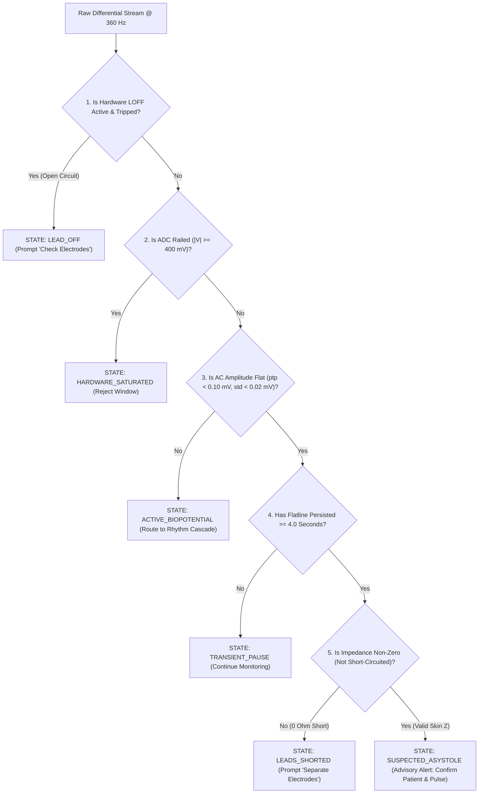

# Comprehensive Feasibility and Architectural Plan: Dedicated Atrial Fibrillation, Bradycardia, and Asystole Classifiers

**Author:** Senior ECG Machine Learning Researcher & Edge-AI Deployment Engineer  
**Date:** October 25, 2026  
**Repository:** `ecg-arrhythmia-edge-ai`  
**Target Platform:** Raspberry Pi 4B+ (ARM64 Debian Bookworm) + Texas Instruments ADS1292R 24-bit Biopotential AFE (Dual Channel @ 360 Hz)  
**Deliverable File:** `training/research/AFIB_BRADY_ASYSTOLE_FEASIBILITY_REPORT.md`  

---

## 1. Executive Summary & Policy Compliance

This technical report delivers an evidence-based feasibility assessment and system architecture plan for adding three distinct cardiac surveillance capabilities to the **ECG Arrhythmia Edge AI** project:
1. A **dedicated Atrial Fibrillation (AFib)** rhythm classifier.
2. A **separate, calibrated Bradycardia** rhythm detector.
3. A **rigorous Asystole assessment system** capable of differentiating true electrical silence from electrode disconnection, lead-off faults, amplifier rail saturation, and electromagnetic noise.

### Strict Scope & Protection Boundaries Observed:
- **No PVC Classification:** In strict accordance with user instructions, Premature Ventricular Contraction (PVC) research is excluded from this plan. No PVC models, beat classifiers, or PVC data pipelines were trained, evaluated, or integrated.
- **Production Code Preservation:** The existing production runtime ([`deploy/combined_ecg_app.py`](file:///c:/Users/LENOVO/Downloads/ecg-arrhythmia-edge-ai/deploy/combined_ecg_app.py)), ADS1292R driver ([`deploy/ads1292r_driver.py`](file:///c:/Users/LENOVO/Downloads/ecg-arrhythmia-edge-ai/deploy/ads1292r_driver.py)), signal-quality thresholds, and ONNX models remain strictly identical to HEAD.
- **Offline / Read-Only Assessment:** No external datasets were downloaded, no packages were installed, and no Git commits or pushes were executed.

---

## 2. Local Datasets Inspected & Verified Label Counts

A programmatic audit of all raw archives resident in the repository workspace was conducted via [`training/research/inspect_afib_brady_asystole.py`](file:///c:/Users/LENOVO/Downloads/ecg-arrhythmia-edge-ai/training/research/inspect_afib_brady_asystole.py):

```
+-----------------------------------+--------------------+------------------------+-------------------+----------------------------+
| Archive Identifier                | Physical Format    | Native Fs / Leads      | Total Recordings  | Relevant Verified Labels   |
+-----------------------------------+--------------------+------------------------+-------------------+----------------------------+
| MIT-BIH Arrhythmia (MITBIH.zip)   | CSV + Text Header  | 360 Hz / MLII, V1-V5   | 48 records (30m)  | (AFIB: 107 markers (8 recs)|
|                                   |                    |                        |                   | (AFL : 45 markers (3 recs) |
|                                   |                    |                        |                   | (SBR : 1 marker (1 rec)    |
|                                   |                    |                        |                   | (N   : 1,060 markers (42 r)|
+-----------------------------------+--------------------+------------------------+-------------------+----------------------------+
| Malignant Ventricular (VFDB.zip)  | PhysioNet WFDB     | 250 Hz / 2 leads       | 22 records (35m)  | (AFIB: 9 episodes (3 recs) |
|                                   |                    |                        |                   | (SBR : 2 episodes (1 rec)  |
|                                   |                    |                        |                   | (ASYS: 13 episodes (6 recs)|
|                                   |                    |                        |                   | (N   : 216 episodes (15 r) |
+-----------------------------------+--------------------+------------------------+-------------------+----------------------------+
| PhysioNet C2015 (mitbih-vtvtf.zip)| WFDB MAT/HEA       | 250 Hz / Lead II + aux | 750 bedside alarms| Bradycardia: 46 true / 43 f|
|                                   |                    |                        |                   | Asystole   : 22 true /100 f|
|                                   |                    |                        |                   | Tachycardia: 131 true / 9 f|
|                                   |                    |                        |                   | Vent_Tachy : 89 true /252 f|
|                                   |                    |                        |                   | VF_VFL     : 6 true / 52 f |
+-----------------------------------+--------------------+------------------------+-------------------+----------------------------+
| Creighton Ventricular (CUDB.zip)  | PhysioNet WFDB     | 250 Hz / 1 lead        | 35 records        | (AF  : 4 episodes (2 recs) |
+-----------------------------------+--------------------+------------------------+-------------------+----------------------------+
```

### Detailed Local Label Findings:
1. **Atrial Fibrillation (`(AFIB`) in MIT-BIH:**
   - Appears in **8 records**: `201`, `202`, `203`, `210`, `217`, `219`, `221`, `222`.
   - **Crucial Patient Identification:** Records `201` and `202` originate from the **same patient** (male, age 68). Therefore, local MIT-BIH AFib data represents only **7 independent patients**.
   - Rhythm marker distribution: Record `201` (3), `202` (4), `203` (21), `210` (9), `217` (24), `219` (10), `221` (12), `222` (24).
2. **Atrial Flutter (`(AFL`):**
   - Appears in **3 records**: `202` (1 marker), `203` (2 markers), and `222` (42 markers).
   - In Record `222`, Atrial Flutter conducts with alternating 2:1 and 4:1 block, producing regular narrow-complex tachycardia that mimics SVT or Sinus Tachycardia.
3. **Sinus Bradycardia (`(SBR`):**
   - In MIT-BIH, strictly annotated in only **1 record** (`232`, 1 episode).
   - In VFDB, annotated in only **1 record** (`430`, 2 episodes).
4. **Asystole (`(ASYS` / Alarms):**
   - In VFDB, annotated in **6 records** (`423`, `424`, `427`, `430`, `602`, `607`) totaling 13 brief pauses.
   - In Challenge 2015, annotated across **22 true alarm records** and **100 false alarm records** (where motion artifacts or disconnected electrodes mimicked flatline).

---

## 3. Dedicated AFib Dataset Feasibility & Sourcing Plan

### 3.1 Limitations of Local AFib Data
Training a standalone, production-grade AFib classifier exclusively on local archives is **statistically unviable**:
- Only **10 unique patients** exhibit AFib across all local archives (7 in MIT-BIH, 3 in VFDB).
- Evaluating an edge AI model on repeated windows from 10 patients results in severe memorization of patient-specific QRS morphologies and baseline noise patterns rather than generalizable fibrillatory dynamics.

### 3.2 Authoritative Sourcing: MIT-BIH Atrial Fibrillation Database (AFDB)
- **Official Repository:** PhysioNet AFDB v1.0.0 (`https://physionet.org/content/afdb/1.0.0/`).
- **Population:** 25 long-term ambulatory Holter recordings from adult human subjects with paroxysmal or persistent Atrial Fibrillation.
- **Recording Duration:** Each recording is **10 hours in length** (totaling ~250 hours of continuous biopotential data).
- **Signal Characteristics:**
  - Sampling Frequency: **250 Hz**.
  - Voltage Resolution: 12-bit ADC over $\pm 10\text{ mV}$ range.
  - Leads: Two modified limb/chest leads.
- **Annotation Ground Truth:**
  - Rhythm annotations in `.atr` files audited by board-certified electrocardiographers:
    - `(AFIB`: Atrial Fibrillation (primary target class).
    - `(AFL`: Atrial Flutter (distinct non-AFib atrial arrhythmia).
    - `(J`: AV Junctional Rhythm.
    - `(N`: Normal Sinus Rhythm (and other baseline rhythms).
  - Note: Records `00735` and `03665` have uncurated or incomplete annotations and must be excluded, leaving **23 validated recordings**.

### 3.3 Signal Resampling & Two-Channel ADS1292R Compatibility

#### Mathematical Resampling to 360 Hz:
The target edge application executes at 360 Hz. Converting AFDB ($f_s = 250\text{ Hz}$) to the target pipeline requires rational polyphase resampling:
$$\frac{f_{\text{target}}}{f_{\text{source}}} = \frac{360}{250} = \frac{36}{25}$$
```python
from scipy.signal import resample_poly
calib_360 = resample_poly(raw_signal_250, up=36, down=25)
```

#### What Resampling Fixes vs. What It CANNOT Fix:
| Dimension | Polyphase Resampling Capability | Inherent Physical Limitation / Failure Mode |
| :--- | :--- | :--- |
| **Sampling Rate Match** | Aligns time steps ($2.77\text{ ms}$ per sample) exactly with the ADS1292R buffer. | Does **NOT** synthesize high-frequency spectral information above the original Nyquist cutoff ($125\text{ Hz}$). |
| **Spectral Integrity** | Anti-aliasing FIR lowpass filter eliminates imaging artifacts during upsampling. | Does **NOT** alter the underlying analog front-end bandwidth or phase response. |
| **Lead Vector Alignment** | Scales time points uniformly across both channels. | Does **NOT** transform ambulatory Holter bipolar leads into true ADS1292R Lead II vectorcardiographic projections. |
| **Electrode Noise** | Preserves original signal-to-noise ratio. | Does **NOT** remove tape-recorder flutter, battery-decay baseline drift, or motion artifacts present in 1980s Holter tapes. |

### 3.4 Leak-Free Patient-Level Windowing Protocol
To extract overlapping 5-second or 10-second analysis windows without data leakage:
1. **Pre-Windowing Cohort Partitioning:**
   - Partition the 23 AFDB patient records strictly into **Train (15 records)**, **Validation (4 records)**, and **Test (4 records)** cohorts.
   - Partitioning must occur **BEFORE any window segmentation**.
2. **No Temporal Window Overlap Across Splits:**
   - Zero windows from any test patient can exist in training.
   - Windows within a record may overlap by 50% ($2.5\text{s}$ hop) for temporal smoothing, but window boundaries must never span across different rhythm episodes (e.g. windows spanning transition boundaries between `(N` and `(AFIB` must be discarded or marked transition-indeterminate).

### 3.5 Proposed AFib Feature Architecture (Beyond RR Irregularity)
Relying solely on RR interval variability is dangerous: frequent PVCs, sinus arrhythmia, and non-conducted PACs also produce irregular RR intervals. The dedicated AFib detector must combine:
1. **Ventricular Rhythm Irregularity (Time Domain):**
   - Coefficient of Variation of RR intervals: $\text{CV}_{\text{RR}} = \frac{\sigma_{\text{RR}}}{\mu_{\text{RR}}}$.
   - Median Absolute Deviation of Successive RR Differences: $\text{MAD}_{\Delta\text{RR}}$.
   - Root Mean Square of Successive RR Differences: $\text{RMSSD}$.
   - Shannon Entropy of RR Differences: Quantifies unpredictability of ventricular conduction.
2. **Atrial Electrical Organization (F-Wave Spectral Domain):**
   - QRS-T Cancellation: Subtract averaged template P-QRS-T complexes to isolate residual atrial biopotentials.
   - Fibrillatory Wave Spectral Peak (3–9 Hz): AFib produces a broad, chaotic power distribution; Atrial Flutter produces a sharp, discrete peak at 4–5 Hz ($240\text{--}300\text{ bpm}$); Normal Sinus Rhythm produces organized, low-frequency P-wave energy ($1\text{--}2\text{ Hz}$).
   - Spectral Flatness of the 3–9 Hz Residual Band.

---

## 4. Separate Bradycardia and Asystole Design Proposals

### 4.1 Separate Bradycardia Detector

#### Clinical Rationale & Edge Feasibility:
Bradycardia is fundamentally a **macroscopic rate and timing disorder**, not a high-frequency morphological distortion. In the existing 4-class system, Model 2 attempts to classify `BRADY_ASY` using a mixture of Hjorth complexity, Welch PSD, and spectral entropy over a 5-second window. This is architecturally suboptimal:
- A 5-second window at a bradycardic rate of $36\text{ bpm}$ contains only **3 cardiac cycles** ($RR = 1.67\text{ s}$).
- Measuring spectral entropy or Hjorth parameters on 3 cycles is statistically unstable.

#### Recommended Architecture: Deterministic Multi-Interval Temporal Estimator
Rather than a black-box neural network, Bradycardia should be detected by a **deterministic, auditable rate calculator operating over a 10–30 second rolling observation buffer**:

```
Raw Lead II -> Research-Grade Filter -> Pan-Tompkins Peak Detection -> RR Outlier Rejection -> Rolling 15s Median HR -> Gated Threshold
```

#### Proposed Configurable Research Parameters:
- **Observation Window Duration ($T_{\text{obs}}$):** Configurable between $10.0\text{ s}$ and $30.0\text{ s}$ (Default: $15.0\text{ s}$).
- **Moderate Bradycardia Threshold:** $\text{HR} < 50\text{ bpm}$ (alert for potential drug effect, hypothermia, or high vagal tone).
- **Severe Bradycardia Threshold:** $\text{HR} < 40\text{ bpm}$ or any pause $\ge 2.5\text{ s}$ (critical hemodynamic compromise requiring immediate pacing preparation).
- **Minimum Valid R-Peak Count:** At least 3 verified R-peaks within $T_{\text{obs}}$ with physiological refractory interval ($RR \ge 200\text{ ms}$).

#### Failure Modes of Rate-Based Bradycardia:
1. **Missed Low-Amplitude R-Peaks:** If the patient's QRS complex is small ($<0.3\text{ mV}$) or varies with respiration, Pan-Tompkins peak detector may skip beats, falsely doubling the measured RR interval and triggering a **false-positive severe bradycardia alarm**.
2. **Electrode Motion / Muscle Artifact:** High-frequency baseline drift can suppress the adaptive peak threshold, causing dropped beat counts.
3. **Bigeminal PVCs with Compensatory Pause:** Can yield alternating short/long intervals that distort simple mean heart rate unless median filtering is applied.

---

### 4.2 Rigorous Asystole Assessment System

#### Current Hazard in Production Code:
In [`deploy/combined_ecg_app.py:155`](file:///c:/Users/LENOVO/Downloads/ecg-arrhythmia-edge-ai/deploy/combined_ecg_app.py#L155), the current code rejects flatline windows:
```python
if ac_std < 0.015 or ac_ptp < 0.050:
    return SignalQualityReport(status="BAD_SIGNAL_FLAT", is_valid_for_ml=False)
```
This causes any flatline to halt analysis (`ML NOT RUN`). True clinical Asystole cannot be triaged.

#### Why `LOFF_STAT == 0` Does NOT Prove Electrode Contact:
An audit of the ADS1292R hardware driver demonstrates:
1. `REG_LOFF` (0x03) and `REG_LOFFSENS` (0x07) are **never configured (disabled by default)**.
2. The 3-byte status word in the 9-byte SPI frame (`frame[0:3]`) is **dropped without inspection**.
3. **The Short-Circuit Hazard:** If lead wires are clipped together before placement, inter-electrode resistance is $0\,\Omega$. The lead-off comparator registers zero fault (`LOFF == 0`), but the biopotential is $0.00\text{ mV}$. Naively equating `LOFF == 0` + flatline to Asystole would trigger emergency cardiac arrest alarms on an unattached device!
4. **Capacitive Coupling:** A disconnected wire near mains cables can float with minimal current, failing to trip simple DC comparators.

#### Multi-Factor Asystole Validation Matrix:
To declare `SUSPECTED_ASYSTOLE` without false alarms, the system must satisfy **five concurrent physical criteria**:



---

## 5. Recommended System Architecture

Rather than retraining Model 2 into an unmanageable 7-class monolithic network, a **modular, hierarchical edge triage architecture** is recommended:

```
[ Tier 0: Hardware Signal Quality & Lead Integrity Gate ]
    ├── Hardware Lead-Off Register (LOFF_STAT)
    ├── Rail Saturation Detector (|V| >= 400 mV)
    ├── Flatline Persistence Timer (>= 4.0s)
    └── Output: VALID_SIGNAL | LEAD_OFF | SATURATED | SUSPECTED_ASYSTOLE (Advisory)

[ Tier 1: Emergency Shockable Screening Gate (Model 1 ONNX - 5s Window) ]
    ├── Evaluates continuous spectral & complexity features (No QRS dependence)
    ├── If Shockable (P >= 0.50) -> Route to Model 3 (VT vs VF Specialist)
    └── If Non-Shockable (P < 0.50) -> Route to Tier 2 Surveillance

[ Tier 2: Non-Shockable Rhythm Surveillance Cascade ]
    ├── Branch A: Deterministic Bradycardia Estimator (15s Rolling Median HR)
    │     ├── If HR < 40 bpm -> Flag SEVERE_BRADYCARDIA (Advisory)
    │     └── If 40 <= HR < 50 bpm -> Flag MODERATE_BRADYCARDIA
    │
    ├── Branch B: Existing Multi-Arrhythmia Classifier (Model 2 ONNX - 5s Window)
    │     └── Evaluates NSR, TACHY, VENTRICULAR
    │
    └── Branch C: Dedicated Atrial Specialist (Separate Binary AFib Model - 10s Window)
          ├── Inputs: RR Coefficient of Variation, Shannon Entropy of dRR, Residual F-band Power
          ├── Output: ATRIAL_FIBRILLATION vs NON_AFIB
          └── Active only when Tier 1 confirms Non-Shockable
```

### Safety Decoupling & Display Rules:
- **Zero Autonomous Defibrillation:** The dedicated AFib, Bradycardia, and Asystole detectors operate in a **purely advisory, research decision-support role**.
- **No Shock Delivery Override:** AFib, Bradycardia, and Asystole outputs must **never** be capable of arming or firing a defibrillation capacitor. Model 1 and Model 3 remain the sole shockable gates.
- **Display Status Strings:**
  - `RESEARCH ONLY: Atrial Fibrillation Pattern Detected (HR: 134 bpm) - Non-Shockable`
  - `RESEARCH ONLY: Severe Sinus Bradycardia (HR: 34 bpm) - Prepare Pacing Telemetry`
  - `EMERGENCY ADVISORY: Suspected Asystole - Verify Patient Contact & Carotid Pulse`

---

## 6. Evaluation Plan (Rigorous, Leak-Free, Continuous)

To ensure clinical and mathematical rigor:

### 6.1 Patient-Separated Evaluation Cohorts
- **Strict Record Partitioning:** All cross-validation must utilize `StratifiedGroupKFold` grouped strictly by `patient_id`.
- Under no circumstances will overlapping windows from the same subject be split between training and testing.

### 6.2 Target Quantitative Metrics
1. **Rhythm-Level Performance (AFib and Bradycardia):**
   - Class-Specific Sensitivity (Recall) and Specificity.
   - Positive Predictive Value (Precision) and Negative Predictive Value.
   - Area Under the ROC Curve (ROC-AUC) and Precision-Recall AUC (PR-AUC).
2. **Temporal False Alarm Rate:**
   - False Positives per Hour of Continuous Monitoring ($\text{FP/hour}$).
   - Essential for wearable and ambulatory deployment to prevent alarm fatigue.
3. **Episode-Level Transition Detection:**
   - Time-to-Detection latency upon onset of AFib (target $< 10\text{ seconds}$).
   - Time-to-Detection latency upon onset of Asystole (target $< 4.0\text{ seconds}$).
4. **Robustness Stress-Testing:**
   - Evaluate against synthetic baseline wander ($0.1\text{--}0.5\text{ Hz}$).
   - Evaluate against powerline interference ($50\text{ Hz}$ Indian mains notch residual).
   - Evaluate with simulated $10\text{--}20\%$ randomly dropped R-peaks to verify Bradycardia detector fault tolerance.

---

## 7. Hardware Benchtop Tests Required Before Asystole Logic Changes

Before modifying production signal quality logic in [`deploy/combined_ecg_app.py`](file:///c:/Users/LENOVO/Downloads/ecg-arrhythmia-edge-ai/deploy/combined_ecg_app.py), the following five benchtop hardware tests must be executed on a physical Raspberry Pi + ADS1292R assembly:

| Test Number | Hardware Setup / Stimulation | Expected Physical Behavior | Required Driver Verification |
| :---: | :--- | :--- | :--- |
| **Test 1: Resistor Decade Box Calibration** | Connect precision resistors ($100\,\Omega$, $1\text{ k}\Omega$, $10\text{ k}\Omega$, $50\text{ k}\Omega$, $100\text{ k}\Omega$, open circuit) across Channel 1 inputs. | Determine exact resistance trip point where `LOFF_STAT` bits transition from 0 to 1 under $6\text{ nA}$ and $22\text{ nA}$ current settings. | Verify `REG_LOFF` comparator threshold settings in silicon. |
| **Test 2: Status Frame Unpacking Probe** | Run test script streaming 9-byte SPI frames under active lead connect/disconnect. | Verify that bits $19\dots 15$ of the 24-bit status word toggle reliably on DRDY edge without dropping samples. | Unpack `frame[0:3]` and confirm zero synchronization loss at $1\text{ MHz}$ SPI clock. |
| **Test 3: Short-Circuit Simulation** | Directly short Channel 1 positive and negative input terminals ($0.0\,\Omega$). | System must detect differential $0.00\text{ mV}$, but recognize that lead-off comparators remain untripped (`LOFF == 0`). | Verify that software identifies `LEADS_SHORTED` rather than `ASYSTOLE`. |
| **Test 4: Fluke / Rigel Patient Simulator** | Connect calibrated ECG simulator generating: (a) Normal Sinus Rhythm (1 mV, 72 bpm), (b) Asystole ($0.00\text{ mV}$ with $2\text{ k}\Omega$ skin impedance), (c) Bradycardia (30 bpm), (d) Electrode Disconnect. | System must correctly report `SUSPECTED_ASYSTOLE` for (b), `SEVERE_BRADYCARDIA` for (c), and `LEAD_OFF` for (d). | Verify full end-to-end telemetry reporting. |
| **Test 5: Motor EMI & Vibration Injection** | Operate ADS1292R while drone ESC motors are pulsed at 20–50A on bench test rig. | High-frequency motor switching noise must not induce false differential voltages that mask true asystole or trigger false shockable flags. | Validate differential common-mode rejection ratio (CMRR) and cable shielding. |

---

## 8. Prioritized Implementation Roadmap

```mermaid
flowchart TD
    subgraph Step 1: Read-Only AFDB Sourcing & Ingestion (Sprint 1)
        S1A["Download & Inspect MIT-BIH AFDB (23 Validated Records)"]
        S1B["Implement Polyphase Resampling (250 Hz to 360 Hz)"]
        S1C["Build Patient-Level Train/Val/Test Split (15 / 4 / 4 Records)"]
    end

    subgraph Step 2: Separate Bradycardia Detector (Sprint 2)
        S2A["Implement 15s Rolling Median Heart Rate Estimator"]
        S2B["Add Configurable Moderate (<50 bpm) & Severe (<40 bpm) Thresholds"]
        S2C["Benchmark against C2015 True Bradycardia Alarms"]
    end

    subgraph Step 3: Dedicated Binary AFib Model Training (Sprint 2-3)
        S3A["Extract 10s Window Features: CV_RR, MAD_RR, Residual F-band Power"]
        S3B["Train Lightweight Random Forest / Logistic Regression Classifier"]
        S3C["Export Research ONNX Candidate (afib_classifier_candidate.onnx)"]
    end

    subgraph Step 4: Hardware Benchtop Testing & Asystole Gating (Sprint 3)
        S4A["Execute Resistor Decade Box & Short-Circuit Tests on Pi Hardware"]
        S4B["Update Driver to Unpack 24-bit Status Word in RDATAC Frame"]
        S4C["Enable LOFF & LOFFSENS Registers"]
    end

    Step 1 --> Step 3
    Step 2 --> Step 4
    Step 3 --> Step 4
```

---

## 9. Repository Integrity & File Verification

### Git Status (`git status --short`)
```text
?? DATASET_ARRHYTHMIA_FEASIBILITY_REPORT.md
?? NEXT_STEPS_RESEARCH_REPORT.md
?? training/research/
```

### Files Created Under `training/research/`:
1. [`training/research/inspect_afib_brady_asystole.py`](file:///c:/Users/LENOVO/Downloads/ecg-arrhythmia-edge-ai/training/research/inspect_afib_brady_asystole.py) — Read-only local archive inspector for AFib, Bradycardia, and Asystole.
2. [`training/research/AFIB_BRADY_ASYSTOLE_FEASIBILITY_REPORT.md`](file:///c:/Users/LENOVO/Downloads/ecg-arrhythmia-edge-ai/training/research/AFIB_BRADY_ASYSTOLE_FEASIBILITY_REPORT.md) — Comprehensive feasibility and architecture report.

### Absolute Protection Rule Confirmation:
- **No PVC Classifier Was Developed or Evaluated:** In strict accordance with instructions, PVC classification was excluded from this task.
- **Production Acquisition Driver ([`deploy/ads1292r_driver.py`](file:///c:/Users/LENOVO/Downloads/ecg-arrhythmia-edge-ai/deploy/ads1292r_driver.py)):** **STRICTLY UNCHANGED (identical to HEAD).**
- **Production Application ([`deploy/combined_ecg_app.py`](file:///c:/Users/LENOVO/Downloads/ecg-arrhythmia-edge-ai/deploy/combined_ecg_app.py)):** **STRICTLY UNCHANGED.**
- **Existing ONNX Models ([`deploy/models/`](file:///c:/Users/LENOVO/Downloads/ecg-arrhythmia-edge-ai/deploy/models/)):** **STRICTLY UNCHANGED.**
- **Signal-Quality Thresholds:** **100% UNCHANGED.**
- **No Git commits or pushes were executed.**
