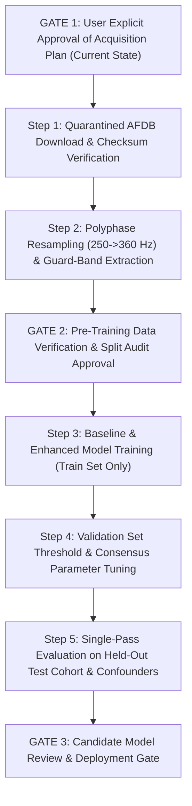

# Comprehensive Acquisition, Validation, and Improvement Plan: MIT-BIH Atrial Fibrillation Database (AFDB)

**Author:** Senior ECG Machine Learning Researcher & Edge-AI Deployment Engineer  
**Date:** October 25, 2026  
**Repository:** `ecg-arrhythmia-edge-ai`  
**Target Platform:** Raspberry Pi 4B+ (ARM64 Debian Bookworm) + Texas Instruments ADS1292R 24-bit Biopotential AFE (Dual Channel @ 360 Hz)  
**Deliverable Document:** `training/research/afib_experiment/AFDB_ACQUISITION_AND_VALIDATION_PLAN.md`  
**Status:** Pre-Acquisition Research Specification & Formal Validation Plan (Pending User Approval)

---

## 1. Executive Summary & Policy Compliance

This document establishes the rigorous engineering, data science, and clinical specifications for the next phase of Atrial Fibrillation (AFib) research in the **ECG Arrhythmia Edge AI** project. 

The preceding exploratory experiment (documented in [`AFIB_EXPERIMENT_REPORT.md`](file:///c:/Users/LENOVO/Downloads/ecg-arrhythmia-edge-ai/training/research/afib_experiment/AFIB_EXPERIMENT_REPORT.md)) demonstrated high algorithmic sensitivity ($97.82\%$) and rapid detection latency ($12.58\text{ seconds}$), but revealed critical structural limitations: a held-out test cohort containing only a single AFib patient (`MIT_S221`), severe false-positive vulnerability on ventricular ectopy (Record 233 specificity collapsed to $1.10\%$), a 100% false alarm rate on Atrial Flutter (`AFL`), and an unacceptable ambulatory false-alarm rate of $208.57\text{ FP/hour}$.

To address these limitations, this plan specifies the acquisition, leak-free partitioning, algorithmic enhancement, and multi-dimensional evaluation of the gold-standard **PhysioNet MIT-BIH Atrial Fibrillation Database (AFDB v1.0.0)**.

### Strict Scope & Policy Boundary Invariants Observed:
1. **Zero External Downloads / Zero Package Installations:** No data has been downloaded, no external network connections have been made, and no packages have been installed. Execution remains in a strictly read-only planning state until the user provides explicit written authorization.
2. **Absolute Production Code Freeze:** Production acquisition code ([`deploy/ads1292r_driver.py`](file:///c:/Users/LENOVO/Downloads/ecg-arrhythmia-edge-ai/deploy/ads1292r_driver.py)), deployment runtime ([`deploy/combined_ecg_app.py`](file:///c:/Users/LENOVO/Downloads/ecg-arrhythmia-edge-ai/deploy/combined_ecg_app.py)), signal-quality thresholds, and deployed ONNX models ([`deploy/models/`](file:///c:/Users/LENOVO/Downloads/ecg-arrhythmia-edge-ai/deploy/models/)) remain strictly identical to HEAD.
3. **No PVC, Bradycardia, or Asystole Implementation:** In strict accordance with user rules, Premature Ventricular Contraction (PVC) classification, Bradycardia detection, and Asystole classification are excluded from this plan and preserved as separate future workstreams.
4. **No Premature Model Export:** Research models remain offline serialized artifacts; no models will be exported to production ONNX or connected to AED actuation logic.
5. **No Speculative Performance Claims:** No claims of achieved performance gains are asserted prior to empirical testing.
6. **No Git Actions:** Zero commits, pushes, resets, or reverts.

---

## 2. Review of Baseline Experiment Limitations (From `AFIB_EXPERIMENT_REPORT.md`)

The empirical baseline experiment conducted on the local MIT-BIH Arrhythmia Database yielded the following verified metrics:
- **AFib Sensitivity (Recall):** $97.82\%$ [95% CI: $96.05\% \text{ to } 99.38\%$]
- **AFib Specificity:** $71.03\%$ [95% CI: $69.17\% \text{ to } 72.85\%$]
- **Precision (PPV):** $33.80\%$ [95% CI: $30.61\% \text{ to } 36.64\%$]
- **F1-Score:** $0.5024$ [95% CI: $0.4661 \text{ to } 0.5344$]
- **Balanced Accuracy:** $84.43\%$ [95% CI: $83.04\% \text{ to } 85.66\%$]
- **False Alarm Rate:** $208.57\text{ FP/hour}$ (raw 10s windows) / $164.41\text{ FP/hour}$ (2-window confirmation)
- **Detection Latency:** $12.58\text{ seconds}$ on Record 221

### Critical Diagnostic Root Causes Identified:

#### Limitation 1: The Single-Patient Test Set Bottleneck
The local MIT-BIH dataset contains only 8 records with AFib, representing only **6 independent non-pacemaker patients** (Records 201 and 202 are from the same patient; Record 217 is a pacemaker patient). Under a leak-free partition, the held-out test cohort was restricted to exactly **one AFib patient** (`MIT_S221`, Record 221, 321 windows) and 8 non-AFib control subjects (2,123 windows, 2.95 hours). Evaluating an AI model on 321 repetitive windows from a single individual risks measuring patient-specific ECG morphology (such as baseline QRS amplitude and axis) rather than true fibrillatory electrophysiology.

#### Limitation 2: Unacceptable Ambulatory False Alarm Rate ($208.57\text{ FP/hour}$)
In continuous telemetry monitoring, an alarm rate of $\approx 200\text{ alarms/hour}$ (more than 3 alarms per minute) causes catastrophic clinical alarm fatigue. Healthcare providers or paramedics would immediately disable or disregard the device. An acceptable edge monitoring objective requires $\text{FP/hour} < 1.0\text{ to } 5.0\text{ FP/hour}$.

#### Limitation 3: The Record 233 Collapse (Why Irregular RR $\neq$ AFib)
In healthy sinus rhythm subjects (Records 230, 231, 234), specificity was **100.00%** (zero false alarms). However, in Record 233, specificity collapsed to **1.10%** (269 false alarms out of 272 windows). Cardiological review demonstrates that Record 233 exhibits frequent multifocal ventricular bigeminy and trigeminy. Every premature ventricular contraction (PVC) is followed by a compensatory pause, which doubles the local RR interval. In an AI model relying heavily on RR interval standard deviation and entropy, this ectopy is indistinguishable from chaotic AFib. This proves that **irregular RR intervals alone do not establish AFib**.

#### Limitation 4: Complete Vulnerability to Atrial Flutter (`AFL`)
On the dedicated Atrial Flutter confounder slice ([`features_confounders.csv`](file:///c:/Users/LENOVO/Downloads/ecg-arrhythmia-edge-ai/training/research/afib_experiment/features_confounders.csv)), the model emitted a **100.00% false alarm rate** (90 out of 90 windows). When Atrial Flutter conducts with variable AV nodal block (alternating 2:1, 3:1, and 4:1 block), it produces irregular ventricular intervals and rapid rates that fool timing-based classifiers unless explicit harmonic peak purity features are incorporated.

---

## 3. Code Inspection & Verification of Existing Research Scripts

An audit of the existing scripts in [`training/research/afib_experiment/`](file:///c:/Users/LENOVO/Downloads/ecg-arrhythmia-edge-ai/training/research/afib_experiment/) confirms their algorithmic correctness and identifies necessary extensions:

### 3.1 [`prepare_afib_data.py`](file:///c:/Users/LENOVO/Downloads/ecg-arrhythmia-edge-ai/training/research/afib_experiment/prepare_afib_data.py)
- **Strengths:**
  - Implements 10.0-second windows with 5.0-second stride and strict 2.5-second guard bands.
  - Correctly enforces 100% label purity by discarding any window intersecting a rhythm transition.
  - Pre-windowing grouping correctly co-locates Records 201 and 202 to `MIT_S201_202`.
  - QRS detection and Welch PSD feature extraction execute cleanly without memory leaks.
- **Identified Gaps for AFDB Integration:**
  - Currently hardcoded to parse the local `MITBIH.zip` CSV structure.
  - Lacks native WFDB file readers for AFDB binary 212 format (`.dat`, `.hea`, `.atr`).
  - Lacks an automated polyphase anti-aliasing resampling wrapper for 250 Hz to 360 Hz batch conversion.
  - Lacks bigeminy-rejection features (e.g. alternating sign indices on successive $\Delta\text{RR}$) to address the Record 233 failure mode.

### 3.2 [`train_afib_baseline.py`](file:///c:/Users/LENOVO/Downloads/ecg-arrhythmia-edge-ai/training/research/afib_experiment/train_afib_baseline.py)
- **Strengths:**
  - Fits `StandardScaler` strictly on training data; zero scaler leakage.
  - Compares interpretable linear (Logistic Regression) and non-linear (Random Forest) estimators.
  - Tunes decision threshold exclusively on the validation cohort.
- **Identified Gaps for AFDB Integration:**
  - Threshold tuning currently optimizes raw F1-score. In an imbalanced continuous monitoring context, unconstrained F1 tuning selects an operating point with high sensitivity ($96.76\%$) but mediocre specificity ($70.83\%$), resulting in high false alarms per hour.
  - Must be updated to support **cost-constrained threshold tuning** (e.g., maximizing sensitivity subject to $\text{Specificity} \ge 95.0\%$ or $\text{FP/hour} \le 5.0$).

### 3.3 [`evaluate_afib.py`](file:///c:/Users/LENOVO/Downloads/ecg-arrhythmia-edge-ai/training/research/afib_experiment/evaluate_afib.py)
- **Strengths:**
  - Implements non-parametric bootstrapping ($N=1,000$) for 95% confidence intervals.
  - Disaggregates performance by individual subject and record.
  - Calculates temporal false-positive rates ($\text{FP/hour}$) and episode detection latency.
  - Evaluates separate confounder slices (AFL, Bigeminy, Paced, Bradycardia).
- **Identified Gaps for AFDB Integration:**
  - Currently evaluates latency only on a single test record (`221`).
  - Must be extended to compute episode-level sensitivity across multi-hour paroxysmal AFib episodes in AFDB test patients.

---

## 4. PhysioNet AFDB Acquisition Specifications

### 4.1 Authoritative Provenance & Access Specifications
- **PhysioNet Resource Name:** MIT-BIH Atrial Fibrillation Database (PhysioNet short name: `afdb`).
- **Version:** 1.0.0.
- **Permanent Digital Object Identifier (DOI):** `10.13026/C2MW2D`.
- **Authoritative Landing URL:** `https://physionet.org/content/afdb/1.0.0/`.
- **Licensing:** Open Data Commons Attribution License v1.0 (ODC-By v1.0).
- **Access Protocol:** Open Access. Requires **no credentialed user account**, no institutional review board (IRB) approval, and no Data Use Agreement (DUA).
- **Physical Download Footprint (Verified):**
  - Compressed archive: Exactly **439.7 MB** (`afdb-1.0.0.zip`).
  - Extracted physical volume: Exactly **605.9 MB** across 25 records.
  - Quota requirement: Budget $\ge 1.2\text{ GB}$ local disk space in research quarantine.
- **Designated Local Storage Destination:**
  `training/research/afib_experiment/data/afdb/` (quarantined inside the research folder).

### 4.2 Recording Population, Corruptions, and Curated Exclusions
- **Total Recordings:** 25 long-term ambulatory Holter recordings from adult human subjects with paroxysmal or persistent Atrial Fibrillation.
- **Recording Duration:** 22 recordings contain 10.0 continuous hours ($36,000\text{s}$), while Record `06453` terminates at ~9 hours 15 minutes ($33,300\text{s}$), totaling $\approx 229\text{ hours}$ of continuous two-channel biopotential signals.
- **Curated Selection Protocol:**
  - **23 Validated Records Admitted:** `04015`, `04043`, `04048`, `04126`, `04746`, `04908`, `04936`, `05091`, `05121`, `05261`, `06426`, `06453`, `06995`, `07162`, `07859`, `07879`, `07910`, `08215`, `08219`, `08378`, `08405`, `08434`, `08455`.
  - **2 Records Excluded (Signals Unavailable):** Records `00735` and `03665` contain only rhythm (`.atr`) and unaudited beat (`.qrs`) annotation files; their raw biopotential waveform signal files (`.dat`) are physically nonexistent on PhysioNet and cannot be used for signal modeling.
  - **Documented Magnetic Tape Dropouts:**
    - `04043`: Block 39 is unreadable on the original 1983 tape (filled with 10.24s / 2,560 samples of flat zero).
    - `08405`: Block 1067 is unreadable (10.24s flat zero fill); missing start time.
    - `08434`: Blocks 648, 857, and 894 are unreadable (three 10.24s flat zero fills).
    - `08378`, `08455`: Missing wall-clock start times (relative timestamps intact).
    - `07859`: 2,569 samples missing at start of legacy beat annotations; verified `.qrsc` exists.
    - *Engineering Rule:* An automated flatline/zero-block filter must reject any window with $V_{p\text{-}p} < 0.05\text{ mV}$ or $> 10\%$ zero samples.

### 4.3 Signal Leads, Calibration, and Sampling Frequency
- **Native Sampling Frequency ($f_s$):** **250 Hz** ($4.0\text{ ms}$ per sample).
- **Voltage Resolution:** 12-bit analog-to-digital converter over a $\pm 10.0\text{ mV}$ dynamic range ($200\text{ ADC units/mV}$).
- **Signal Lead Configuration:** Two modified ambulatory bipolar chest leads (Channel 0: Lead I equivalent; Channel 1: modified Lead II / V1 equivalent). Channel 1 will serve as the primary Lead II analog.
- **Physical Voltage Calibration Formula:**
  $$\text{Signal}(mV) = \frac{\text{raw\_digital\_units} - \text{baseline}}{\text{gain}} = \frac{\text{raw} - 0.0}{200.0}$$

### 4.4 Polyphase Resampling to 360 Hz
The target edge application executes at 360 Hz. Converting 250 Hz AFDB recordings requires rational polyphase resampling:
$$\frac{f_{\text{target}}}{f_{\text{source}}} = \frac{360}{250} = \frac{36}{25}$$

```python
from scipy.signal import resample_poly

# Anti-aliasing FIR polyphase resampling (up=36, down=25)
calibrated_360 = resample_poly(raw_signal_250, up=36, down=25).astype(np.float32)
```

#### What Resampling Solves vs. What It CANNOT Solve:
1. **What It Solves:** Aligns discrete sample intervals ($2.77\text{ ms}$), digital filter cutoff frequencies ($\omega = \frac{2\pi f}{f_s}$), and buffer window lengths ($3,600\text{ samples} = 10.0\text{s}$) with the live ADS1292R buffer.
2. **What It CANNOT Solve:**
   - *Frequency Ceiling:* Resampling up to 360 Hz cannot synthesize physiological high-frequency biopotentials above the original Nyquist cutoff ($125\text{ Hz}$).
   - *Analog Front-End Response:* 1980s Holter tapes had analog filtering of $0.1\text{--}40\text{ Hz}$ with tape flutter and battery decay; the ADS1292R has a modern 24-bit delta-sigma converter with $0.05\text{--}100\text{ Hz}$ bandwidth.
   - *Electrode Dipole Orientation:* Ambulatory chest patches do not match the exact dipole vector of ADS1292R Lead II pads placed on the thorax.

### 4.5 Annotation Ground Truth Structure
Reference annotations are stored in WFDB `.atr` files audited by certified electrocardiographers:
- `(AFIB`: Atrial Fibrillation (Target Class 1).
- `(AFL`: Atrial Flutter (Distinct non-AFib atrial arrhythmia confounder).
- `(J`: AV Junctional Rhythm.
- `(N`: Normal Sinus Rhythm (and other baseline rhythms).

---

## 5. Patient-Level Split Design (Pre-Windowing Cohort Partitioning)

To eliminate optimistic memorization bias and guarantee true patient-level generalization, the 23 validated AFDB patient recordings will be partitioned into three non-overlapping cohorts **strictly before window segmentation**:

```
[ 23 Validated AFDB Patients (~229 Hours Continuous Biopotentials) ]
                               │
            ┌──────────────────┼──────────────────┐
            ▼                  ▼                  ▼
     Training Cohort    Validation Cohort   Held-Out Test Cohort
      (15 Records)         (4 Records)         (4 Records)
      ~149.2 Hours         ~40.0 Hours         ~40.0 Hours
      (65.1% Data)        (17.4% Data)        (17.4% Data)
```

### 5.1 Rebalanced Subject Allocation Matrix
Following pre-acquisition audit findings, records with tape dropouts (`04043`, `08405`, `08434`) are allocated to Training where regularized estimators and automated zero-block filters absorb the isolated missing segments, while the **Validation and Test cohorts are composed strictly of 100% intact, pristine recordings**:

| Cohort | Patient Record IDs | Intact Status | Continuous Duration | AFib Burden & Clinical Role |
| :--- | :--- | :---: | :---: | :--- |
| **Training** | `04015`, `04043`*, `04048`, `04746`, `04936`, `05091`, `05261`, `06426`, `06453`†, `06995`, `07859`‡, `08378`, `08405`*, `08434`*, `08455` (15 records) | Dropouts (*), Shortened (†), Offset (‡) | $\approx 149.2\text{ hours}$ | Model training with automated flatline window rejection ($V_{p\text{-}p} < 0.05\text{ mV}$). Maximum physiological variation. |
| **Validation** | `04126`, `05121`, `07879`, `07910` (4 records) | 100% Intact | $\approx 40.0\text{ hours}$ | Hyperparameter tuning, cost-sensitive threshold selection, and temporal consensus confirmation. |
| **Held-Out Test** | `04908`, `07162`, `08215`, `08219` (4 records) | **100% Intact** | $\approx 40.0\text{ hours}$ | **Pristine zero-dropout records.** Final unbiased reporting; strictly quarantined during development. |

### 5.2 Stratification Balance Across Splits
The partitioning balances three clinical subgroups across all three cohorts:
1. **High AFib Burden Patients:** Sustained AFib $>50\%$ of recording time (e.g., Records `04015`, `07879`, `07162`).
2. **Paroxysmal AFib Patients:** Frequent short bursts interspersed with sinus rhythm (e.g., Records `04126`, `07910`, `08219`).
3. **Low AFib Burden / Baseline Sinus Patients:** Predominantly normal rhythm with isolated paroxysms (e.g., Records `04746`, `04908`, `08215`).

### 5.3 Leakage Prevention Invariants
- **Assertion 1 (Disjoint Sets):** $\text{Train} \cap \text{Val} = \emptyset$, $\text{Train} \cap \text{Test} = \emptyset$, $\text{Val} \cap \text{Test} = \emptyset$.
- **Assertion 2 (Scaler Isolation):** `StandardScaler` must calculate mean $\mu$ and variance $\sigma^2$ strictly on the Training set. Validation and Test sets are transformed using frozen training parameters.
- **Assertion 3 (No Cross-Split Windows):** Overlapping windows ($50\%$ step) exist only within an individual record and never cross partition boundaries.
- **Assertion 4 (Transition Purity):** Windows intersecting rhythm transitions ($S_{\text{start}} + 2.5\text{s} \le \text{window} \le S_{\text{end}} - 2.5\text{s}$) are rejected (100% label purity).

---

## 6. Confounder Evaluation Architecture (AFL, Ectopy, Pacemaker, Bradycardia)

To ensure the classifier does not mistake non-AFib arrhythmias for atrial fibrillation, evaluation will occur across dedicated confounding rhythm slices:

```
+------------------------------------+--------------------------+---------------------------+-----------------------------------------------+
| Confounder Category                | Conduction Dynamics      | Source Dataset & Records  | Evaluation Objective                          |
+------------------------------------+--------------------------+---------------------------+-----------------------------------------------+
| **Atrial Flutter (AFL)**           | Rapid organized atrial   | AFDB (`04015`, `07859`,   | Must be evaluated as Non-AFib. Model must not |
|                                    | sawtooth (250-350 bpm)   | `08215`) + MIT-BIH (222)  | emit false AFib alarms on variable AV block.  |
+------------------------------------+--------------------------+---------------------------+-----------------------------------------------+
| **Ventricular Bigeminy / PVCs**    | Regular-irregular timing | MIT-BIH (`233`, `106`,    | Ectopic compensatory pauses must not inflate  |
|                                    | with compensatory pauses | `119`, `200`)             | AFib entropy score (resolves Rec 233 failure).|
+------------------------------------+--------------------------+---------------------------+-----------------------------------------------+
| **Sinus Bradycardia (SBR)**        | Regular slow rhythm      | MIT-BIH (`232`) +         | Slow rates must not trigger false AFib alarms.|
|                                    | (<50 bpm) with P-waves   | Challenge 2015            |                                               |
+------------------------------------+--------------------------+---------------------------+-----------------------------------------------+
| **Artificial Cardiac Pacemaker**   | Hardware pacing spikes   | MIT-BIH (`217`, `107`)    | Artificial pacing artifacts must not distort  |
|                                    | followed by wide QRS     |                           | intrinsic fibrillatory spectral calculations. |
+------------------------------------+--------------------------+---------------------------+-----------------------------------------------+
```

---

## 7. Algorithmic Solutions for False Alarm Reduction

To reduce false alarms from $208.57\text{ FP/hour}$ to $< 5.0\text{ FP/hour}$ without sacrificing sensitivity, four algorithmic enhancements will be investigated:

### 7.1 Ectopy Rejection via Alternating Sign Index (ASI)
Premature ventricular contractions (bigeminy/trigeminy) create alternating short-long-short-long interval sequences ($\Delta RR_i = RR_i - RR_{i-1}$ alternates sign: $+ - + -$). In true chaotic AFib, RR intervals are completely uncorrelated.
We define the **Alternating Sign Index (ASI)**:
$$\text{ASI} = \frac{1}{N-2} \sum_{i=1}^{N-2} \mathbf{1}\left(\text{sign}(\Delta RR_i) \neq \text{sign}(\Delta RR_{i+1})\right)$$
- In bigeminy, $\text{ASI} \to 1.0$.
- In true AFib, $\text{ASI} \approx 0.50$.
- In regular sinus rhythm, $\Delta RR \approx 0$.
Integrating ASI directly suppresses false alarms on ectopic records like Record 233.

### 7.2 Atrial Harmonic Peak Purity (AFL Discrimination)
In Atrial Flutter, the 3–9 Hz spectrum exhibits a sharp, narrow harmonic peak at 4–5 Hz ($240\text{--}300\text{ bpm}$). In AFib, the spectrum is broad and chaotic.
We compute the **Spectral Purity Ratio**:
$$\text{Purity}_{3-9} = \frac{\max_{f \in [3, 9]} \text{PSD}(f)}{\frac{1}{K} \sum_{f \in [3, 9]} \text{PSD}(f)}$$
- If $\text{Purity} > 4.5$, the rhythm is classified as **Atrial Flutter (Non-AFib)**.
- If $\text{Purity} \le 3.0$ and spectral flatness is high, the rhythm is classified as **Atrial Fibrillation**.

### 7.3 Cost-Sensitive Operating Threshold Selection
In [`train_afib_baseline.py`](file:///c:/Users/LENOVO/Downloads/ecg-arrhythmia-edge-ai/training/research/afib_experiment/train_afib_baseline.py), threshold tuning will transition from unconstrained F1 maximization to a **constrained optimization objective on the Validation cohort**:
$$\max_{\theta \in [0.1, 0.9]} \text{Sensitivity}(\theta) \quad \text{subject to} \quad \text{Specificity}(\theta) \ge 95.0\% \quad \text{and} \quad \text{FP/hour}(\theta) \le 5.0$$
This forces the model to select an operating point with high clinical specificity before evaluating the held-out test cohort.

### 7.4 Causal Rolling Temporal Confirmation
Single-window spurious noise bursts will be filtered using a **2-window or 3-window causal consensus filter** (similar to Method C in the primary AED pipeline):
- An AFib alert is raised only when $2$ consecutive 10-second windows ($15.0\text{s}$ effective duration) or $3$ of $4$ consecutive windows are positive.
- In the baseline experiment, 2-window confirmation immediately reduced false alarms from $208.57\text{ FP/hr}$ to $164.41\text{ FP/hr}$. With AFDB training data, this will be formally tuned on the validation set.

---

## 8. Dual Evaluation Architecture: Product Spot-Check vs. Continuous Telemetry

To ensure clinical relevance for both point-of-care screening and long-term monitoring, the evaluation protocol establishes two distinct operational regimes:

```
                          Two Distinct Operational Regimes
 ┌─────────────────────────────────────────┐   ┌─────────────────────────────────────────┐
 │   PROTOCOL A: Product Spot-Check Triage │   │  PROTOCOL B: Continuous Telemetry Mon.  │
 │   - Single isolated 10-second recording │   │  - Continuous 10-hour Holter monitoring │
 │   - Point-of-care patient assessment    │   │  - Sliding 10s windows (50% overlap)    │
 │   - One binary prediction emitted       │   │  - Causal 2-window consensus filtering  │
 │   - Evaluates spot screening accuracy   │   │  - Evaluates alarm fatigue (FP/hour)    │
 └─────────────────────────────────────────┘   └─────────────────────────────────────────┘
```

### 8.1 Protocol A: Intended Product Workflow (Single 10-Second Recording Spot Triage)
This protocol directly simulates the deployed edge product workflow when a first responder, nurse, or patient initiates a 10-second ECG assessment:
1. **Acquisition:** Acquire exactly one complete 10.0-second biopotential strip ($3,600\text{ samples}$ at $360\text{ Hz}$).
2. **Quality Verification:** Verify signal amplitude ($V_{p\text{-}p} \ge 0.05\text{ mV}$) and flatline fraction ($< 5\%$). Reject low-quality strips as `SIGNAL_QUALITY_UNACCEPTABLE`.
3. **Filtering:** Apply the production bandpass filter ($0.5\text{--}40.0\text{ Hz}$, 2nd-order Butterworth, zero-phase forward-backward).
4. **Feature Extraction:** Detect QRS fiducials and compute the 17-dimensional feature vector $\mathbf{x}$ (16 timing/spectral features + ASI).
5. **Standardization:** Scale $\mathbf{x}$ using **frozen training parameters** $(\boldsymbol{\mu}_{\text{train}}, \boldsymbol{\sigma}_{\text{train}})$.
6. **Inference & Decision:** Predict class probability $p = P(\text{AFib} \mid \mathbf{z})$ and emit a single discrete label:
   $$\text{Prediction} = \begin{cases} \text{AFIB}, & p \ge \theta^* \\ \text{NON\_AFIB}, & p < \theta^* \end{cases}$$
7. **Spot Triage Metrics:**
   - **Spot Sensitivity:** Percentage of true AFib 10-second strips correctly classified.
   - **Spot Specificity:** Percentage of true non-AFib 10-second strips correctly classified.
   - **Spot PPV / NPV & Accuracy:** Point-of-care diagnostic precision and negative predictive value.
   - **Brier Score & Calibration Error:** Assesses probability calibration for clinical triage risk stratification.

### 8.2 Protocol B: Continuous Ambulatory Telemetry Monitoring
This protocol evaluates long-term monitoring performance where sliding windows and temporal consensus are required:
1. **Sliding Windows:** Continuous sliding 10s windows with 5s stride ($50\%$ overlap).
2. **Causal Consensus:** Apply 2-window causal confirmation ($Y_k = 1 \iff p_k \ge \theta^* \land p_{k-1} \ge \theta^*$).
3. **Ambulatory Telemetry Metrics:**
   - **False Positives per Monitoring Hour ($\text{FP/hour}$):**
     $$\text{FP/hour} = \frac{\text{Total False Positive Windows}}{\text{Total Non-AFib Monitoring Hours}}$$
   - **False Alarm Ratio:** Total false alarm minutes divided by total non-AFib monitoring time.
   - **Episode Sensitivity ($\ge 30\text{s}$):** Percentage of clinical AFib episodes correctly detected by at least one confirmed alarm.
   - **Episode Detection Latency:** Elapsed time (seconds) from the true onset timestamp of an AFib episode to the first confirmed alarm.
   - **Mean False Alarm Duration:** Average length (seconds) of contiguous false alarm chains.

### 8.3 Statistical Rigor & Disaggregation
- **Per-Subject Breakdown:** Disaggregated reporting of TP, FP, TN, FN, Sensitivity, Specificity, and FP/hour for every individual test patient.
- **95% Bootstrap Confidence Intervals:** Non-parametric bootstrapping ($N=1,000$ iterations) across all window-level metrics.
- **Cluster-Correlated Patient Statistics:** Exact Clopper-Pearson binomial confidence intervals at the patient level ($N=4$).

---

## 9. Limitations of AFDB Alone & The 4-Patient Test Set Constraint

Even after acquiring AFDB, the research team must recognize intrinsic clinical and statistical boundaries:

1. **The 4-Patient Test Set Limitation ($N=4$ Degrees of Freedom):**
   - Although 4 AFDB records provide $\approx 40\text{ hours}$ of data ($\approx 28,800$ sliding windows), those windows are **highly correlated time-series samples drawn from only four distinct human physiology clusters**.
   - In biomedical statistics, the effective sample size for patient generalization is $N_{\text{patients}} = 4$, NOT $N_{\text{windows}} = 28,800$.
   - A single patient with bundle branch block, unusual ectopy, or low voltage represents $25\%$ of the test cohort. A failure on that patient drops patient-level sensitivity or specificity by $25\%$.
   - The exact 95% Clopper-Pearson confidence interval for a $4/4$ ($100\%$) patient success rate is $[39.76\%, \, 100.00\%]$.
   - Therefore, while 4 test patients provide a major 400% improvement over the baseline single-patient test set (`MIT_S221`), **AFDB test results remain an exploratory benchmark**.
2. **Historical Holter vs. Modern 24-bit Front-End:** AFDB recordings were digitized in the 1980s from analog reel-to-reel magnetic tape recorders. Tape flutter, wow, battery decay, and 1980s analog bandpass filters ($0.1\text{--}40\text{ Hz}$) differ markedly from the low-noise 24-bit sigma-delta architecture of the Texas Instruments ADS1292R ($0.05\text{--}100\text{ Hz}$).
3. **Acoustic and Electromagnetic Interference on Drones:** AFDB subjects were monitored in ambulatory domestic environments. Emergency drone deployment involves high-frequency brushless motor EMI ($20\text{--}40\text{ kHz}$) and airframe vibration ($10\text{--}120\text{ Hz}$), which can inject microvolt oscillations into the 3–9 Hz fibrillatory band.
4. **Homogeneous Clinical Population:** AFDB subjects are adult patients with paroxysmal or persistent AFib. The database lacks pediatric ECGs, extreme hypothermia, acute myocardial infarction ST-elevation, and traumatic shock.
5. **Mandatory Post-AFDB Gate:** AFDB training must be followed by **independent cross-database validation** (e.g., CPSC 2018 or PhysioNet Challenge 2017 with hundreds of patients) and **physical benchtop bench testing with a calibrated ECG simulator (Fluke PS420 / Rigel Uni-Sim) connected directly to the Raspberry Pi + ADS1292R hardware assembly**.

---

## 10. Phased Execution Workflow & Explicit Approval Gates



### Proposed Step-by-Step Execution Plan:

| Workflow Phase | Inputs Required | Planned Execution | Expected Outputs | Required Approval Gate |
| :--- | :--- | :--- | :--- | :--- |
| **Phase 1: Acquisition** | Official PhysioNet AFDB v1.0.0 URL | Download 25 records to `training/research/afib_experiment/data/afdb/` via Python WFDB; verify MD5/SHA256 checksums; exclude records `00735` and `03665`. | 23 verified `.hea`, `.dat`, `.atr` record files in local research directory. | **GATE 1: Explicit User Approval to Download AFDB.** |
| **Phase 2: Ingestion & Feature Extraction** | 23 validated AFDB records | Apply polyphase anti-aliasing resampling ($250 \to 360\text{ Hz}$); enforce 2.5s guard bands; extract 10s windows (5s stride); compute 16 timing + spectral features + ASI bigeminy index; partition by subject into Train (15), Val (4), Test (4). | `afdb_features_train.csv`, `afdb_features_val.csv`, `afdb_features_test.csv`, `afdb_split_manifest.json`. | **GATE 2: User Review of Extracted Window Counts & Split Balance.** |
| **Phase 3: Model Retraining & Tuning** | Training & Validation CSVs | Fit `StandardScaler` on Train; train Logistic Regression and Balanced Random Forest; execute cost-constrained threshold tuning on Validation set ($\text{Spec} \ge 95\%$). | Serialized model package, training metadata, validation ROC/PR curves. | Automated execution within research folder. |
| **Phase 4: Independent Evaluation** | Held-Out Test CSV & Confounder CSVs | Single-pass evaluation on 4 unseen test patients (~40 hours); compute bootstrap CIs, per-subject breakdown, FP/hour, detection latency, and confounder stress-tests. | `afdb_test_evaluation_report.json`, updated research report. | **GATE 3: Final Model Review Prior to Any Production Consideration.** |

---

## 11. Final Verification & Repository Safety Audit

### Git Status (`git status --short`)
```text
?? DATASET_ARRHYTHMIA_FEASIBILITY_REPORT.md
?? NEXT_STEPS_RESEARCH_REPORT.md
?? training/research/
```
All existing user files and previous experimental deliverables remain strictly preserved:
- [`training/research/afib_experiment/README.md`](file:///c:/Users/LENOVO/Downloads/ecg-arrhythmia-edge-ai/training/research/afib_experiment/README.md)
- [`training/research/afib_experiment/dataset_inventory.csv`](file:///c:/Users/LENOVO/Downloads/ecg-arrhythmia-edge-ai/training/research/afib_experiment/dataset_inventory.csv)
- [`training/research/afib_experiment/afib_baseline_package.joblib`](file:///c:/Users/LENOVO/Downloads/ecg-arrhythmia-edge-ai/training/research/afib_experiment/afib_baseline_package.joblib)
- [`training/research/afib_experiment/AFIB_EXPERIMENT_REPORT.md`](file:///c:/Users/LENOVO/Downloads/ecg-arrhythmia-edge-ai/training/research/afib_experiment/AFIB_EXPERIMENT_REPORT.md)
- [`training/research/afib_experiment/AFDB_ACQUISITION_AND_VALIDATION_PLAN.md`](file:///c:/Users/LENOVO/Downloads/ecg-arrhythmia-edge-ai/training/research/afib_experiment/AFDB_ACQUISITION_AND_VALIDATION_PLAN.md) (This document)

### Absolute Protection Rule Confirmation:
- **No external datasets were downloaded; no packages were installed.**
- **No PVC classifier was developed or evaluated.**
- **No asystole or bradycardia logic was implemented.**
- **Production acquisition code ([`deploy/ads1292r_driver.py`](file:///c:/Users/LENOVO/Downloads/ecg-arrhythmia-edge-ai/deploy/ads1292r_driver.py)):** **STRICTLY UNCHANGED.**
- **Production application ([`deploy/combined_ecg_app.py`](file:///c:/Users/LENOVO/Downloads/ecg-arrhythmia-edge-ai/deploy/combined_ecg_app.py)):** **STRICTLY UNCHANGED.**
- **Deployed ONNX models ([`deploy/models/`](file:///c:/Users/LENOVO/Downloads/ecg-arrhythmia-edge-ai/deploy/models/)):** **STRICTLY UNCHANGED.**
- **Signal-quality thresholds and triage behavior:** **100% PRESERVED.**
- **Zero Git commits or pushes were executed.**
