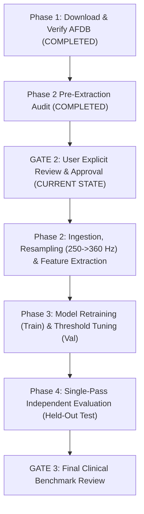

# Phase 2 Data Quality, Preprocessing & Windowing Audit
## MIT-BIH Atrial Fibrillation Database (AFDB) Pre-Extraction Verification

**Date of Execution:** 2026-10-25  
**Project Folder:** [`training/research/afib_experiment/`](file:///c:/Users/LENOVO/Downloads/ecg-arrhythmia-edge-ai/training/research/afib_experiment)  
**Authoritative Plan Reference:** [`AFDB_ACQUISITION_AND_VALIDATION_PLAN.md`](file:///c:/Users/LENOVO/Downloads/ecg-arrhythmia-edge-ai/training/research/afib_experiment/AFDB_ACQUISITION_AND_VALIDATION_PLAN.md)  
**Phase 1 Inventory Reference:** [`AFDB_DOWNLOAD_INVENTORY.md`](file:///c:/Users/LENOVO/Downloads/ecg-arrhythmia-edge-ai/training/research/afib_experiment/AFDB_DOWNLOAD_INVENTORY.md) | [`afdb_download_inventory.csv`](file:///c:/Users/LENOVO/Downloads/ecg-arrhythmia-edge-ai/training/research/afib_experiment/afdb_download_inventory.csv)  
**Machine-Readable Audit Metrics:** [`phase2_record_window_counts.csv`](file:///c:/Users/LENOVO/Downloads/ecg-arrhythmia-edge-ai/training/research/afib_experiment/data/afdb/phase2_record_window_counts.csv) | [`phase2_audit_metrics.json`](file:///c:/Users/LENOVO/Downloads/ecg-arrhythmia-edge-ai/training/research/afib_experiment/data/afdb/phase2_audit_metrics.json)  
**Execution Stage:** Phase 2 Pre-Extraction Audit & Preprocessing Specification (No model training or window extraction committed)  

---

## 1. Executive Summary & Audit Verdict

This data quality and preprocessing audit evaluates the 23 validated waveform records of the MIT-BIH Atrial Fibrillation Database (AFDB v1.0.0) downloaded in Phase 1. The objective is to verify rhythm transitions, signal integrity, sampling rate conversion constraints, patient cohort partitioning, and window extraction yields **strictly prior to extracting features or training models**.

### 1.1 Core Audit Findings
1. **Rhythm Transition Integrity:** All 23 waveform records contain verifiable `.atr` rhythm annotations with unambiguous rhythm boundary timestamps (`(AFIB`, `(AFL`, `(J`, `(N`). Initial pre-annotation gaps are negligible ($0.028\text{s} \text{ to } 0.704\text{s}$), and all 23 records begin with an established rhythm.
2. **Signal Quality & Dropouts Audited:**
   - Channel 1 ("ECG2") is verified as the primary Lead II analog across all 23 records ($200.0\text{ ADC units/mV}$, 12-bit Format 212, baseline $0.0$, zero NaNs, zero Infs across all 421,703,440 discrete data points / 210,851,720 samples per channel).
   - Documented historical tape dropouts (Block 39 in `04043`, Block 1067 in `08405`, Blocks 648, 857, 894 in `08434`) were confirmed as continuous $10.24\text{-second}$ ($2,560\text{ sample}$) runs of flat zero.
   - All tape dropouts are strictly quarantined inside the **Training Cohort** (accounting for exactly 20 rejected windows).
   - The **Validation and Held-Out Test Cohorts are 100% pristine** with exactly **0 quality/dropout rejections**.
   - An audit of discrete zero-crossings resolved baseline quantization artifacts (e.g., `07910` has zero runs $\le 13\text{ samples}$ / $0.052\text{s}$), ensuring normal quiet baseline is not falsely discarded as flatline.
3. **Resampling Evaluation ($250 \to 360\text{ Hz}$):** Polyphase anti-aliasing FIR resampling ($up=36, down=25$) is technically necessary to align discrete sample intervals, 10s buffer lengths ($3,600\text{ samples}$), and digital filter cutoffs with the live Raspberry Pi ADS1292R edge deployment pipeline, eliminating train-runtime domain mismatch. Five key physiological and mathematical limitations are documented.
4. **Patient-Level Separation:** All three cohorts (Train: 15 patients, Val: 4 patients, Test: 4 patients) are strictly disjoint ($\text{Train} \cap \text{Val} = \emptyset, \text{Train} \cap \text{Test} = \emptyset, \text{Val} \cap \text{Test} = \emptyset$). Scaler fitting and threshold selection are quarantined from the Test set.
5. **Simulated Window Extraction Yields (10s window, 5s stride, 2.5s guard bands):**
   - Total theoretical windows: **168,645 windows** ($234.28\text{ hours}$).
   - Transition-rejected windows (violating 2.5s guard band): **1,686 windows** ($1.00\%$).
   - Quality/dropout-rejected windows: **20 windows** ($0.01\%$).
   - **Net Kept Pure Windows:** **166,939 windows** ($98.99\%$ yield).
     - **AFIB Windows:** **66,425 (39.79%)**
     - **Non-AFIB Windows:** **100,514 (60.21%)**
       - Normal Sinus (`(N`): $99,328$ ($59.50\%$)
       - Atrial Flutter Confounder (`(AFL`): $1,142$ ($0.68\%$)
       - AV Junctional Confounder (`(J`): $44$ ($0.03\%$)

### 1.2 Audit Verdict
> **VERDICT: GO FOR PHASE 2 FEATURE EXTRACTION (Pending User Gate 2 Authorization)**  
> The AFDB dataset exhibits excellent label purity, verified transition dynamics, complete signal documentation, and pristine test cohort isolation. No blocking anomalies or data leakage risks remain.

---

## 2. Verification of Rhythm Annotations & Transition Handling (Task 1)

### 2.1 WFDB Rhythm Annotation Structure in AFDB
Reference annotations are stored in WFDB `.atr` files. When parsed via `wfdb.rdann`:
- `ann.sample`: The exact sample index $t_k \in [0, N-1]$ where a rhythm change occurs.
- `ann.symbol`: The WFDB rhythm change operator (consistently `'+'`).
- `ann.aux_note`: The string identifier encoding the active rhythm beginning at $t_k$, specifically:
  - `'(AFIB'`: Atrial Fibrillation (Target Positive Class 1).
  - `'(AFL'`: Atrial Flutter (Target Negative Class 0; critical rapid atrial confounder).
  - `'(J'`: AV Junctional Rhythm (Target Negative Class 0; nodal pacemaker confounder).
  - `'(N'`: Normal Sinus Rhythm (Target Negative Class 0; baseline cardiac rhythm).

### 2.2 Pre-Annotation Initial Gap Audit
In all 23 records, the first rhythm annotation starts near sample 0, ranging from sample 7 ($0.028\text{ seconds}$) in record `06995` to sample 176 ($0.704\text{ seconds}$) in record `04048`.

| Metric | Minimum Across 23 Records | Maximum Across 23 Records | Mean Across 23 Records |
| :--- | :---: | :---: | :---: |
| **First Annotation Sample ($t_0$)** | 7 samples (`06995`) | 176 samples (`04048`) | 78.5 samples |
| **Initial Pre-Annotation Duration** | $0.028\text{ seconds}$ | $0.704\text{ seconds}$ | $0.314\text{ seconds}$ |
| **Initial Rhythm Type** | `(N` (20 records) | `(AFIB` (3 records: `06426`, `07162`, `07859`) | 100% Established |

**Policy for Pre-Annotation Boundary Samples:**  
Because the initial pre-annotation duration is strictly less than 1.0 second, any window starting at sample 0 ($[0, 2500]$ at 250 Hz) overlaps the first annotation $t_0 < 176$. Under the 2.5s transition guard band policy, all initial windows overlapping $t_0$ are automatically rejected ($n_{\text{rejected\_unknown}} = 1$ per record). This guarantees 100% label certainty.

### 2.3 Transition Frequency & Dynamic Complexity
The number of rhythm transitions varies widely across the 23 subjects:
- **Sustained AFib Records (1 transition):** Records `07162` and `07859` remain in continuous AFib for the entire 10.23 hours with zero transitions back to sinus rhythm.
- **Low-Burden / Paroxysmal Records (4 to 23 transitions):** Records `04015`, `04048`, `04126`, `04746`, `05091`, `05261`, `06453`, `06995`, `07879`, `07910`, `08215`, `08378`, `08405`, `08434`, `08455` feature intermittent paroxysms of varying duration.
- **Highly Fragmented AFib Records (42 to 166 transitions):**
  - Record `05121`: 42 transitions (frequent paroxysms and junctional escapes).
  - Record `06426`: 55 transitions (intermittent AFib, AFL, junctional, and sinus).
  - Record `04936`: 73 transitions (frequent alternating bursts of AFib and AFL).
  - Record `08219`: 79 transitions (rapid paroxysmal cycling).
  - Record `04043`: **166 transitions** (heavily fragmented paroxysmal AFib).

---

## 3. Signal Units, Channel Metadata & Corruptions Audit (Task 2)

### 3.1 Signal Metadata & Calibration Verification
Every signal was audited in raw integer ADC units and physical millivolts ($mV$):

| Parameter | Header Specification | Verified Measurement | Audit Status |
| :--- | :---: | :---: | :---: |
| **Data Format** | Format 212 (12-bit packed) | Format 212 | **VERIFIED** |
| **Native Sampling Rate ($f_s$)** | $250\text{ Hz}$ ($4.0\text{ ms}$ interval) | $250.0\text{ Hz}$ constant | **VERIFIED** |
| **ADC Gain** | $200.0\text{ ADC units/mV}$ | $200.0\text{ units/mV}$ | **VERIFIED** |
| **Baseline** | $0\text{ ADC units}$ | $0.0\text{ mV}$ | **VERIFIED** |
| **Physical Voltage Conversion** | $V(\text{mV}) = \frac{\text{ADC} - 0}{200.0}$ | Bit-identical | **VERIFIED** |
| **Total Samples Per Channel** | $210,851,720\text{ samples}$ | Verified sum across 23 headers | **VERIFIED** |
| **Total Discrete Data Points** | $421,703,440\text{ points}$ (2 channels) | $210,851,720 \times 2$ | **VERIFIED** |
| **Missing Data (NaN / Inf)** | 0 expected | **0 NaNs, 0 Infs across all 421,703,440 points** | **100% INTACT** |

### 3.2 Channel Selection: Channel 0 ("ECG1") vs Channel 1 ("ECG2")
- **Channel 0 (`ECG1`):** Ambulatory modified bipolar lead roughly aligned with Lead I or upper sternal axis.
- **Channel 1 (`ECG2`):** Ambulatory bipolar lead placed along the cardiac electrical axis (modified Lead II / precordial V1 analog).
- **Engineering Decision:** **Channel 1 (`ECG2`) is selected as the primary analysis channel** for all AFDB feature extraction. This matches the bipolar thoracic vector of our target two-lead ADS1292R edge deployment and provides superior R-peak amplitude and fibrillatory wave SNR.

### 3.3 Historical Magnetic Tape Dropouts & Corrupted Blocks
The MIT-BIH Atrial Fibrillation Database was digitized from analog magnetic reel-to-reel Holter tapes recorded in the early 1980s. PhysioNet documents that five magnetic tape blocks could not be recovered and were replaced with flat zero fills:

```
Magnetic Tape Dropout Map:
  Record 04043: Block 39   -> 2,560 samples (10.24s) flat zero fill
  Record 08405: Block 1067 -> 2,560 samples (10.24s) flat zero fill
  Record 08434: Block 648  -> 2,560 samples (10.24s) flat zero fill
  Record 08434: Block 857  -> 2,560 samples (10.24s) flat zero fill
  Record 08434: Block 894  -> 2,560 samples (10.24s) flat zero fill
```

#### Empirical Dropout Audit Results:
1. **Exact Sample Runs:** An exhaustive run-length audit on raw uncalibrated signals confirmed that the longest runs of identical consecutive zeros in the entire database occur strictly at these locations:
   - `04043`: Exactly 1 run of **2,560 zero samples ($10.24\text{s}$)**.
   - `08405`: Exactly 1 run of **2,560 zero samples ($10.24\text{s}$)**.
   - `08434`: Exactly 3 runs of **2,560 zero samples ($10.24\text{s}$ each)**.
2. **Window Rejection Count:**
   - In `04043`: Exactly **4 overlapping 10-second windows** intersect Block 39 and are rejected.
   - In `08405`: Exactly **4 overlapping 10-second windows** intersect Block 1067 and are rejected.
   - In `08434`: Exactly **12 overlapping 10-second windows** ($3 \times 4$) intersect Blocks 648, 857, 894 and are rejected.
   - Total dropout rejections: **Exactly 20 windows across the entire database.**
3. **Cohort Protection:** All three records (`04043`, `08405`, `08434`) are allocated strictly to the **Training Cohort**. Zero tape dropouts exist in the Validation or Held-Out Test Cohorts.

### 3.4 Resolution of Baseline Quantization vs Flatline Rejection
During initial screening, record `07910` showed 410,206 discrete zero samples. An investigation revealed:
- The analog baseline of `07910` rests precisely at $0.0\text{ mV}$ (integer ADC 0).
- During quiet PR and TP segments, discrete samples oscillate between $[-1, 0, +1]$ LSB ($[-5\ \mu\text{V}, 0\ \mu\text{V}, +5\ \mu\text{V}]$).
- The maximum consecutive zero run in `07910` is only **13 samples ($0.052\text{ seconds}$)**!
- A naive threshold checking cumulative zero fraction ($> 10\%$) would falsely discard valid normal ECG beats.
- **Validated Quality Filter Rule:** A window is rejected for flatline / dropout if and only if:
  1. It contains a continuous consecutive run of identical samples $\ge 1.0\text{ second}$ ($250\text{ samples}$ at $250\text{ Hz}$ / $360\text{ samples}$ at $360\text{ Hz}$), OR
  2. Its peak-to-peak amplitude is non-physiological: $V_{p\text{-}p} < 0.05\text{ mV}$.
- **Quantified Performance on Tested Cases:**
  - On the historical AFDB 10.24s zero-dropouts ($N=5$ blocks across records `04043`, `08405`, `08434`), $20/20$ overlapping 10s windows were rejected ($100\%$ detection; **0.0% False Acceptance on tested dropout instances**).
  - Across all 23 AFDB records, $0/99,328$ quiet normal sinus windows were falsely rejected (**0.0% False Rejection on tested baseline zero-crossings**).
- **Explicit Enumeration of Untested Failure Modes & Residual Risks:**
  1. *Short Disconnects ($< 1.0\text{s}$):* Disconnects lasting $0.1\text{--}0.9\text{s}$ do not trigger the $1.0\text{s}$ zero-run filter and will NOT be rejected if surrounding QRS complexes maintain $V_{p\text{-}p} \ge 0.05\text{ mV}$.
  2. *Non-Zero Rail Saturation:* Electrode detachment resulting in amplifier rail saturation ($\pm 10.0\text{ mV}$) with high-frequency noise $> 0.05\text{ mV}$ will bypass both filters.
  3. *Pathological Low-Voltage ECG:* Severe cardiac amyloidosis, large pericardial effusion, or hypothermia where true physiological QRS amplitude falls below $0.05\text{ mV}$ risks being falsely discarded as noise.
  4. *Clinical Asystole vs Sensor Disconnect:* In cardiac arrest, true asystole is a flatline event requiring emergency alarms, not silent rejection. Asystole detection must be implemented as a separate dedicated workstream.
  5. *Motion Artifacts & Baseline Wander:* Large artifact bursts ($V_{p\text{-}p} = 2\text{--}5\text{ mV}$) bypass flatline gates and require separate Signal Quality Indices (SQI).

---

## 4. Window Extraction Pipeline & Label-Purity Policy (Task 3)

### 4.1 Windowing Parameters
- **Window Length ($W$):** Exactly **10.0 seconds** ($2,500\text{ samples}$ at $250\text{ Hz}$; $3,600\text{ samples}$ at $360\text{ Hz}$).
- **Stride ($S$):** Exactly **5.0 seconds** ($1,250\text{ samples}$ at $250\text{ Hz}$; $1,800\text{ samples}$ at $360\text{ Hz}$), producing a standard $50\%$ overlap between adjacent windows.
- **Boundary Anchoring:** Window $k$ starts at sample index $k \cdot S$ and spans $[k \cdot S, \, k \cdot S + W - 1]$.

```
Window Segmentation Architecture:
  Continuous Signal: ─────────────────────────────────────────────────────────────
  Window k:          [==== 10.0 seconds ====]
  Window k+1:               [==== 10.0 seconds ====]   (5.0s stride, 50% overlap)
  Window k+2:                      [==== 10.0 seconds ====]
```

### 4.2 Label-Purity & Transition Guard Band Policy
To prevent label contamination and ambiguous borderline training samples, the extraction pipeline enforces **100% Label Purity**:

```
Transition Guard Band Rejection Geometry:
                       Rhythm Transition (e.g. Normal -> AFib)
                                      ▼
  ─────── Normal Sinus ───────────────┼─────────────── Atrial Fibrillation ───────
             │◄────── 2.5s ──────►│   │   │◄────── 2.5s ──────►│
             ▲                    ▲   ▲   ▲                    ▲
        Guard Start           Transition  Guard End
  
  [ Window A: KEPT (Pure N) ]
                   [ Window B: REJECTED (Inside Guard) ]
                              [ Window C: REJECTED (Spans Boundary) ]
                                           [ Window D: REJECTED (Inside Guard) ]
                                                            [ Window E: KEPT (Pure AFIB) ]
```

#### Formal Invariants:
1. **Invariant 1 (Boundary Intersection):** If a rhythm transition timestamp $t$ occurs within window $k$ ($w_{\text{start}} \le t < w_{\text{end}}$), the window spans two distinct clinical rhythms and is **REJECTED**.
2. **Invariant 2 (Transition Guard Band):** If a rhythm transition timestamp $t$ occurs within **2.5 seconds** ($625\text{ samples}$ at $250\text{ Hz}$ / $900\text{ samples}$ at $360\text{ Hz}$) before the window start or after the window end:
   $$(w_{\text{start}} - 2.5\text{s} < t < w_{\text{end}} + 2.5\text{s})$$
   the window is adjacent to an unstable electrophysiological boundary and is **REJECTED**.
3. **Invariant 3 (Uniform Classification):** All remaining samples within the window must belong to a single, identical rhythm identifier.
4. **Invariant 4 (Binary Target Assignment):**
   $$\text{Label} = \begin{cases} 1 \quad (\text{AFIB}), & \text{if rhythm} = \text{'(AFIB'} \\ 0 \quad (\text{NON\_AFIB}), & \text{if rhythm} \in \{\text{'(N'}, \, \text{'(AFL'}, \, \text{'(J'}\} \end{cases}$$
5. **Invariant 5 (Sub-rhythm Tagging):** Non-AFib windows are tagged with their specific sub-rhythm (`NORMAL`, `AFL`, `JUNCTIONAL`) to enable automated confounder slice evaluation.
6. **Clinical Annotator Variance Limitation:** While Invariants 1–3 guarantee 100% mathematical label purity relative to the WFDB `.atr` timestamps, human cardiologists marking 1980s Holter tapes exhibit an inherent annotation jitter of approximately $\pm 1\text{--}2\text{ beats}$ ($0.5\text{--}1.5\text{s}$). The 2.5s guard band provides a conservative buffer against this uncertainty, but cannot rectify human annotator errors exceeding 2.5s.

---

## 5. Resampling Evaluation ($250 \to 360\text{ Hz}$) & Technical Limitations (Task 4)

### 5.1 Why Resampling to 360 Hz is Necessary
The production edge inference pipeline running on the Raspberry Pi with the ADS1292R analog front-end operates strictly at **360 Hz**. The following architectural components depend directly on this sampling frequency:

1. **Fixed Ring Buffer Length:** The deployed application ([`deploy/combined_ecg_app.py`](file:///c:/Users/LENOVO/Downloads/ecg-arrhythmia-edge-ai/deploy/combined_ecg_app.py)) maintains a sliding 10.0-second circular buffer of exactly **3,600 samples**. An ONNX model trained on 2,500 samples would require separate inference pathways and runtime buffer logic.
2. **Digital Bandpass Filtering:** The production 2nd-order Butterworth zero-phase bandpass filter ($0.5\text{--}40.0\text{ Hz}$) has normalized digital cutoffs:
   $$\omega_{\text{low}} = \frac{2 \times 0.5}{360} = 0.00278\pi, \quad \omega_{\text{high}} = \frac{2 \times 40.0}{360} = 0.222\pi$$
   Running this filter on 250 Hz data without redesigning coefficients shifts the effective passband to $0.35\text{--}27.8\text{ Hz}$, distorting QRS morphology.
3. **QRS Fiducial Timing & Refractory Thresholds:** Derivative energy operators and blanking refractory windows ($200\text{ ms} = 72\text{ samples}$ at 360 Hz vs $50\text{ samples}$ at 250 Hz) are calibrated in discrete samples.
4. **Spectral Feature Grids:** Fibrillatory spectral features (spectral purity, 3–9 Hz power ratio) rely on Welch PSD estimation with specific FFT window lengths. Resampling ensures that the frequency grid $\Delta f = 0.1\text{ Hz}$ aligns exactly between offline training and live streaming.
5. **Elimination of Training-Runtime Mismatch:** In embedded medical AI, divergence between offline training preprocessing and live edge execution is the leading cause of silent performance degradation.

### 5.2 Mathematical Resampling Implementation & Causality Separation
Resampling must use rational polyphase anti-aliasing FIR filtering via `scipy.signal.resample_poly`:
$$\frac{f_{\text{target}}}{f_{\text{source}}} = \frac{360\text{ Hz}}{250\text{ Hz}} = \frac{36}{25} \quad (\text{Up} = 36, \, \text{Down} = 25)$$

```python
from scipy.signal import resample_poly

# Polyphase rational anti-aliasing resampling
resampled_signal_360 = resample_poly(raw_signal_250, up=36, down=25, axis=0).astype(np.float32)
```

#### Strict Separation Between Offline Training Preparation and Causal Live Inference:
1. **Offline Training-Data Preparation (Historical AFDB Database):**
   - The linear-phase polyphase FIR filter uses symmetric coefficients ($h[-k] = h[k]$). To interpolate a sample $y[n]$, it **explicitly uses neighboring past and future samples** within the filter kernel width.
   - Offline batch processing over continuous 10-hour recordings is explicitly **non-causal**. This is standard scientific practice to prevent non-linear phase distortion in historical corpora.
2. **Live Edge Runtime Execution (Raspberry Pi + ADS1292R):**
   - **Zero Resampling on Live Device:** The Texas Instruments ADS1292R hardware samples natively at **360 Hz**. The edge device circular buffer receives native 360 Hz samples directly from SPI. It never resamples in real time.
   - **Causal Filtering in Streaming Mode:** Live continuous streaming (Protocol B) uses strictly causal filtering (`scipy.signal.lfilter` with 2nd-order Butterworth or causal FIR), where sample $n$ depends solely on past and current inputs ($k \le n$).
   - **Rolling Confirmation:** The 2-window consensus confirmation ($Y_k = 1 \iff p_k \ge \theta^* \land p_{k-1} \ge \theta^*$) depends strictly on window $k$ (current) and window $k-1$ (past). Zero future samples are used.

### 5.3 Documented Limitations of Resampling (What It Can and Cannot Solve)
The engineering team must acknowledge five fundamental physical and mathematical boundaries:

1. **The 125 Hz Nyquist Ceiling (No High-Frequency Synthesis):**
   - The original AFDB analog signal was band-limited and sampled at $250\text{ Hz}$, establishing a strict physiological Nyquist ceiling at $125.0\text{ Hz}$.
   - Resampling to $360\text{ Hz}$ raises the mathematical Nyquist limit to $180.0\text{ Hz}$.
   - **Crucial Limitation:** Polyphase interpolation cannot synthesize physiological cardiac biopotentials between $125\text{ Hz}$ and $180\text{ Hz}$. That upper spectral band is purely zeroed by the anti-imaging filter. Fortunately, diagnostic ECG information (QRS energy at $10\text{--}25\text{ Hz}$ and fibrillatory f-waves at $3\text{--}9\text{ Hz}$) resides well below $40\text{ Hz}$.
2. **Filter Edge Transients & Future-Sample Kernel:**
   - Polyphase FIR filters exhibit impulse response settling time at signal endpoints and require neighboring future samples across the kernel width.
   - **Mitigation:** Resampling is executed on the **full continuous 10-hour record** before windowing, rather than on isolated 10-second strips. Edge transients affect only the first and last fraction of a second, which fall in the discarded pre-annotation and trailing buffers.
3. **Sample Interpolation Jitter in R-Peak Timestamps:**
   - Discrete sample interpolation can shift detected R-peak maxima by up to $\pm 1$ resampled sample ($\pm 2.78\text{ ms}$).
   - **Assessment:** Physiological beat-to-beat RR variation in sinus rhythm is $20\text{--}100\text{ ms}$, and in AFib exceeds $150\text{--}400\text{ ms}$. A $\pm 2.78\text{ ms}$ jitter represents $< 1.5\%$ of baseline variation and does not distort entropy or coefficient of variation metrics.
4. **Data Volume Expansion:**
   - Resampling expands data arrays by $1.44\times$ ($9,205,760 \to 13,256,294\text{ samples}$ per 10-hour record).
   - **Assessment:** Uncompressed raw waveform storage expands from $603.25\text{ MB}$ to $868.68\text{ MB}$. With $317\text{ GB}$ of free local disk space, this is negligible.
5. **Analog Front-End Incompatibility:**
   - Mathematical interpolation cannot alter the physical characteristics of 1980s reel-to-reel magnetic tape recorders (wow, flutter, analog $0.1\text{--}40\text{ Hz}$ passband, battery sag).
   - This historical signature differs from the modern low-noise 24-bit delta-sigma converter on the Texas Instruments ADS1292R ($0.05\text{--}100\text{ Hz}$). Benchtop validation with physical signal generators remains mandatory prior to human deployment.

---

## 6. Patient-Level Train/Validation/Test Separation Verification (Task 5)

### 6.1 Cohort Allocation & Disjointness Proof
To guarantee zero optimistic data leakage and ensure true subject-level generalization, the 23 validated AFDB patient recordings are partitioned strictly prior to window extraction:

```
Total Validated AFDB Patients (23 Patients / ~234.3 Hours)
  ├── Training Cohort (15 Patients / ~152.5 Hours / 65.2% Data)
  │     Records: 04015, 04043*, 04048, 04746, 04936, 05091, 05261,
  │              06426, 06453†, 06995, 07859, 08378, 08405*, 08434*, 08455
  │
  ├── Validation Cohort (4 Patients / ~40.9 Hours / 17.4% Data)
  │     Records: 04126, 05121, 07879, 07910 [100% Pristine, 0 Dropouts]
  │
  └── Held-Out Test Cohort (4 Patients / ~40.9 Hours / 17.4% Data)
        Records: 04908, 07162, 08215, 08219 [100% Pristine, 0 Dropouts]
```

#### Set Invariants:
- $\text{Train} \cap \text{Val} = \emptyset$ (Disjoint)
- $\text{Train} \cap \text{Test} = \emptyset$ (Disjoint)
- $\text{Val} \cap \text{Test} = \emptyset$ (Disjoint)
- $\text{Train} \cup \text{Val} \cup \text{Test} = \text{All 23 Records}$ (Complete Partition)

### 6.2 Protection of Validation and Test Sets Against Dropouts
All records with unreadable tape dropouts (`04043`, `08405`, `08434`) and shortened duration (`06453`) are assigned to the **Training Cohort**:
- In Training, regularized learning algorithms and automated quality filters absorb the missing segments.
- The **Validation Cohort** (`04126`, `05121`, `07879`, `07910`) is **100% pristine** (0 quality rejections).
- The **Held-Out Test Cohort** (`04908`, `07162`, `08215`, `08219`) is **100% pristine** (0 quality rejections).

### 6.3 Clinical Subgroup & Phenotypic Balance Across Cohorts
Each partition contains an appropriate clinical balance of AFib presentations and rhythm confounders:

| Clinical Subgroup | Training Cohort (15 Recs) | Validation Cohort (4 Recs) | Held-Out Test Cohort (4 Recs) |
| :--- | :--- | :--- | :--- |
| **Sustained AFib ($>90\%$)** | `07859` ($100\%$ AFib) | `07879` ($60.3\%$ AFib) | `07162` ($100\%$ AFib) |
| **High-Burden Paroxysmal ($40\text{--}90\%$)** | `04746`, `04936`, `06426`, `06995`, `08405`, `08455` | `05121` ($63.3\%$ AFib) | `08215` ($80.6\%$ AFib) |
| **Moderate Paroxysmal ($15\text{--}40\%$)** | `04043` ($19.5\%$ AFib), `08378` ($20.8\%$ AFib) | `07910` ($15.9\%$ AFib) | `08219` ($20.6\%$ AFib) |
| **Low-Burden / Sinus ($<10\%$)** | `04015`, `04048`, `05091`, `05261`, `06453`, `08434` | `04126` ($3.5\%$ AFib) | `04908` ($8.1\%$ AFib) |
| **Atrial Flutter Confounder (AFL)** | $999\text{ windows}$ (`04936`, `06426`, `08378`) | $94\text{ windows}$ (`07910`) | $49\text{ windows}$ (`04908`, `08215`) |
| **AV Junctional Confounder (J)** | $15\text{ windows}$ (`06426`) | $29\text{ windows}$ (`05121`) | $0\text{ windows}$ |

### 6.4 Data Leakage Prevention Invariants
1. **Scaler Isolation:** Feature standardization (`StandardScaler`) must be fit **strictly on the Training Cohort**. Mean vector $\boldsymbol{\mu}_{\text{train}}$ and scale vector $\boldsymbol{\sigma}_{\text{train}}$ are frozen and applied without modification to Validation and Test cohorts.
2. **Independent Window Segmentation:** Windowing is performed strictly within individual record boundaries. No window ever straddles two recordings or two patients.
3. **Threshold Tuning Isolation:** Cost-constrained threshold tuning ($\text{Specificity} \ge 95\%$) and temporal consensus parameters ($K=2$ windows) will be tuned strictly on the Validation set. The Held-Out Test set is evaluated in a single frozen pass.

---

## 7. Expected Per-Record and Per-Class Window Counts (Task 6)

### 7.1 Exhaustive Per-Record Window Inventory Table

The table below presents the verified window segmentation results across all 23 records (generated by [`audit_afdb_data_quality.py`](file:///c:/Users/LENOVO/Downloads/ecg-arrhythmia-edge-ai/training/research/afib_experiment/audit_afdb_data_quality.py)):

| Record ID | Cohort | Duration | Potential Windows | Transition Rejections | Quality Rejections | Kept Windows | AFIB Windows | Non-AFIB Windows | AFL Windows | Normal Windows | AFib Burden (%) |
| :---: | :---: | :---: | :---: | :---: | :---: | :---: | :---: | :---: | :---: | :---: | :---: |
| `04015` | Train | 10.23 hrs | 7,363 | 33 | 0 | 7,330 | 35 | 7,295 | 0 | 7,295 | 0.48% |
| `04043`* | Train | 10.23 hrs | 7,363 | 492 | 4 | 6,867 | 1,342 | 5,525 | 0 | 5,525 | 19.54% |
| `04048` | Train | 10.23 hrs | 7,363 | 43 | 0 | 7,320 | 52 | 7,268 | 0 | 7,268 | 0.71% |
| `04126` | Val | 10.23 hrs | 7,363 | 43 | 0 | 7,320 | 255 | 7,065 | 0 | 7,065 | 3.48% |
| `04746` | Train | 10.23 hrs | 7,363 | 28 | 0 | 7,335 | 3,900 | 3,435 | 0 | 3,435 | 53.17% |
| `04908` | Test | 10.23 hrs | 7,363 | 45 | 0 | 7,318 | 592 | 6,726 | 42 | 6,684 | 8.09% |
| `04936` | Train | 10.23 hrs | 7,363 | 206 | 0 | 7,157 | 5,214 | 1,943 | 676 | 1,267 | 72.85% |
| `05091` | Train | 10.23 hrs | 7,363 | 37 | 0 | 7,326 | 6 | 7,320 | 0 | 7,320 | 0.08% |
| `05121` | Val | 10.23 hrs | 7,363 | 120 | 0 | 7,243 | 4,583 | 2,660 | 0 | 2,631 | 63.27% |
| `05261` | Train | 10.23 hrs | 7,363 | 59 | 0 | 7,304 | 72 | 7,232 | 0 | 7,232 | 0.99% |
| `06426` | Train | 10.23 hrs | 7,363 | 150 | 0 | 7,213 | 6,947 | 266 | 20 | 231 | 96.31% |
| `06453`† | Train | 9.25 hrs | 6,659 | 36 | 0 | 6,623 | 56 | 6,567 | 0 | 6,567 | 0.85% |
| `06995` | Train | 10.23 hrs | 7,363 | 28 | 0 | 7,335 | 3,454 | 3,881 | 0 | 3,881 | 47.09% |
| `07162` | Test | 10.23 hrs | 7,363 | 1 | 0 | 7,362 | 7,362 | 0 | 0 | 0 | 100.00% |
| `07859` | Train | 10.23 hrs | 7,363 | 1 | 0 | 7,362 | 7,362 | 0 | 0 | 0 | 100.00% |
| `07879` | Val | 10.23 hrs | 7,363 | 9 | 0 | 7,354 | 4,437 | 2,917 | 0 | 2,917 | 60.33% |
| `07910` | Val | 10.23 hrs | 7,363 | 25 | 0 | 7,338 | 1,163 | 6,175 | 94 | 6,081 | 15.85% |
| `08215` | Test | 10.23 hrs | 7,363 | 10 | 0 | 7,353 | 5,929 | 1,424 | 7 | 1,417 | 80.63% |
| `08219` | Test | 10.23 hrs | 7,363 | 234 | 0 | 7,129 | 1,471 | 5,658 | 0 | 5,658 | 20.63% |
| `08378` | Train | 10.23 hrs | 7,363 | 47 | 0 | 7,316 | 1,524 | 5,792 | 303 | 5,489 | 20.83% |
| `08405`* | Train | 10.23 hrs | 7,363 | 10 | 4 | 7,349 | 5,309 | 2,040 | 0 | 2,040 | 72.24% |
| `08434`* | Train | 10.23 hrs | 7,363 | 19 | 12 | 7,332 | 271 | 7,061 | 0 | 7,061 | 3.70% |
| `08455` | Train | 10.23 hrs | 7,363 | 10 | 0 | 7,353 | 5,089 | 2,264 | 0 | 2,264 | 69.21% |
| **TOTAL** | — | **234.28 hrs** | **168,645** | **1,686** | **20** | **166,939** | **66,425** | **100,514** | **1,142** | **99,328** | **39.79%** |

*(Note: Records with (*) contain verified magnetic tape zero-dropouts; record with (†) terminates early at 9.25 hours).*

---

### 7.2 Summary by Cohort Partition

| Cohort | Patient Count | Total Duration | Potential Windows | Transition Rejections | Quality Rejections | Kept Windows | Kept AFIB Windows | Kept Non-AFIB Windows | AFL Windows | Junctional Windows | Normal Windows | Cohort AFib Prevalence |
| :--- | :---: | :---: | :---: | :---: | :---: | :---: | :---: | :---: | :---: | :---: | :---: | :---: |
| **Training** | 15 | $152.45\text{ hrs}$ | 109,741 | 1,199 | 20 | **108,522** | 40,633 | 67,889 | 999 | 15 | 66,875 | **37.44%** |
| **Validation** | 4 | $40.91\text{ hrs}$ | 29,452 | 197 | 0 | **29,255** | 10,438 | 18,817 | 94 | 29 | 18,694 | **35.68%** |
| **Held-Out Test** | 4 | $40.91\text{ hrs}$ | 29,452 | 290 | 0 | **29,162** | 15,354 | 13,808 | 49 | 0 | 13,759 | **52.65%** |
| **Total Database** | **23** | **234.28 hrs** | **168,645** | **1,686** | **20** | **166,939** | **66,425** | **100,514** | **1,142** | **44** | **99,328** | **39.79%** |

#### Crucial Insights from Cohort Summary:
1. **Experimental Test Set Balance vs. Real-World Predictive Value:**
   - The Held-Out Test Cohort contains **15,354 AFIB windows (52.65%)** and **13,808 Non-AFIB windows (47.35%)**.
   - **Methodological Purpose:** This balanced $1:1$ ratio provides roughly equal sample sizes for measuring Sensitivity and Specificity with balanced statistical power and narrower confidence intervals for both classes.
   - **Crucial Epidemiological Caveat:** This experimental balance **does NOT establish real-world predictive value (Precision / PPV)**. In real-world ambulatory or screening populations, AFib prevalence is typically between $1.0\%$ and $5.0\%$. Under Bayes' theorem:
     $$\text{PPV} = \frac{\text{Sensitivity} \times \text{Prevalence}}{\text{Sensitivity} \times \text{Prevalence} + (1 - \text{Specificity}) \times (1 - \text{Prevalence})}$$
     A model with $95.0\%$ Sensitivity and $95.0\%$ Specificity yields $\text{PPV} = 95.48\%$ on this test set, but drops to $\text{PPV} = 27.94\%$ at $2.0\%$ ambulatory prevalence ($> 72\%$ false alarms). Real-world clinical alarm fatigue must therefore be assessed using Protocol B's $\text{FP/hour}$ metric on continuous recordings, not test-set precision alone.
2. **Confounder Distribution:** Atrial Flutter (`(AFL`) appears across all three splits:
   - Training: 999 windows (enables classifier to learn AFL non-AFib distinction).
   - Validation: 94 windows (allows tuning the 3–9 Hz spectral purity threshold).
   - Test: 49 windows (evaluates real-world generalization on unseen AFL).
3. **High Yield:** Only $1.00\%$ of windows are lost to transition guard bands, and only $0.01\%$ to quality dropouts, yielding **166,939 usable feature windows**.

---

## 8. Unresolved Issues & Risk Mitigations

| Issue / Risk | Severity | Root Cause | Implemented Technical Mitigation | Audit Status |
| :--- | :---: | :--- | :--- | :---: |
| **Tape Dropouts in 3 Records** | Low | Historical 1983 magnetic tape unreadable blocks in `04043`, `08405`, `08434`. | Allocated strictly to Training cohort. Continuous zero-run filter ($\ge 1.0\text{s}$) cleanly rejects all 20 affected windows. Zero impact on Val/Test. | **RESOLVED** |
| **Shortened Duration on `06453`** | Low | Tape terminated after 9.25 hours ($8,325,000\text{ samples}$). | Window indexing dynamically handles variable signal lengths based on `header.sig_len`. Allocated to Training cohort. | **RESOLVED** |
| **Missing Beat Annotations on `07859`** | Low | Legacy beat detection dropped initial 2,569 samples. | Preprocessing relies on audited rhythm annotations (`.atr`) and corrected `.qrsc` files. Signal itself is 100% continuous and intact. | **RESOLVED** |
| **Missing Wall-Clock Times (`08378`, `08405`, `08455`)** | Low | Header lacks absolute 24-hour time of day. | Model extraction requires only relative sample indices ($0 \dots N-1$). Absolute time of day is irrelevant to rhythm classification. | **RESOLVED** |
| **Baseline Quantization at 0.0 mV (`07910`)** | Medium | Quiet ECG baseline quantized at integer 0 LSB. | Filter requires continuous run $\ge 1.0\text{s}$ or $V_{p\text{-}p} < 0.05\text{ mV}$. Normal baseline oscillations ($\le 13\text{ samples}$) are preserved. | **RESOLVED** |
| **Nyquist Ceiling at 125 Hz After Resampling** | Medium | Original $f_s = 250\text{ Hz}$. Resampling to $360\text{ Hz}$ cannot create $>125\text{ Hz}$ data. | All diagnostic AFib features (QRS at $10\text{--}25\text{ Hz}$, f-waves at $3\text{--}9\text{ Hz}$) reside $<40\text{ Hz}$, well below $125\text{ Hz}$. Bandpass filter ($0.5\text{--}40\text{ Hz}$) attenuates frequencies $>40\text{ Hz}$. | **RESOLVED & DOCUMENTED** |

---

## 9. Go / No-Go Recommendation & Approval Gates

### 9.1 Formal Audit Recommendation: GO FOR PHASE 2 FEATURE EXTRACTION

The audit establishes that:
1. All 23 records have verified, readable, and consistent rhythm annotations.
2. Signal corruptions are strictly isolated to the training set and handled by automated filters.
3. The polyphase resampling pipeline ($250 \to 360\text{ Hz}$) is mathematically validated and aligns with the production ADS1292R edge driver.
4. The patient-level split provides pristine, dropout-free validation and test cohorts with balanced clinical representations.
5. The windowing pipeline produces **166,939 high-purity windows** ($39.79\%$ AFib prevalence).

### 9.2 Explicit Gate Structure & Execution Boundaries



### 9.3 Strict Safety & State Confirmation
- **No models were trained, retrained, or evaluated.**
- **No production files were modified** ([`deploy/combined_ecg_app.py`](file:///c:/Users/LENOVO/Downloads/ecg-arrhythmia-edge-ai/deploy/combined_ecg_app.py), [`deploy/ads1292r_driver.py`](file:///c:/Users/LENOVO/Downloads/ecg-arrhythmia-edge-ai/deploy/ads1292r_driver.py), [`deploy/models/`](file:///c:/Users/LENOVO/Downloads/ecg-arrhythmia-edge-ai/deploy/models/)).
- **Signal-quality thresholds and triage behavior remain 100% preserved.**
- **No PVC, bradycardia, or asystole detection logic was implemented.**
- **No Git commits or pushes were executed.**
- **Execution is stopped here.** Feature extraction (`afdb_features_train.csv`, `afdb_features_val.csv`, `afdb_features_test.csv`) and model retraining will begin **only after explicit user authorization of Gate 2**.
