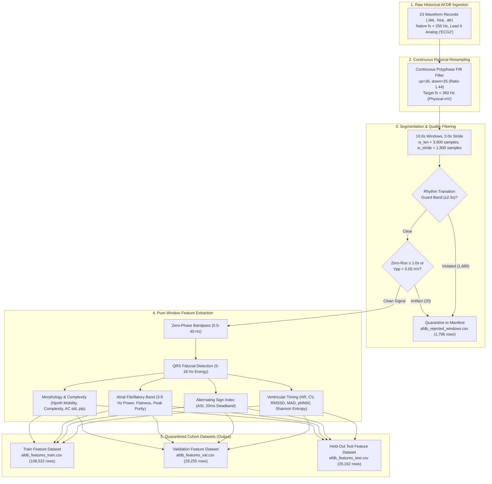

# Phase 2 Feature Extraction and Dataset Verification Report
## MIT-BIH Atrial Fibrillation Database (AFDB v1.0.0) Offline Preprocessing

**Date of Execution:** 2026-10-25  
**Execution Timestamp:** 2026-10-25T11:17:29Z  
**Project Folder:** [`training/research/afib_experiment/`](file:///c:/Users/LENOVO/Downloads/ecg-arrhythmia-edge-ai/training/research/afib_experiment)  
**Extraction Pipeline Script:** [`extract_afdb_features.py`](file:///c:/Users/LENOVO/Downloads/ecg-arrhythmia-edge-ai/training/research/afib_experiment/extract_afdb_features.py)  
**Machine-Readable Extraction Manifest:** [`afdb_extraction_manifest.json`](file:///c:/Users/LENOVO/Downloads/ecg-arrhythmia-edge-ai/training/research/afib_experiment/data/afdb/afdb_extraction_manifest.json)  
**Rejected Windows Manifest:** [`afdb_rejected_windows.csv`](file:///c:/Users/LENOVO/Downloads/ecg-arrhythmia-edge-ai/training/research/afib_experiment/data/afdb/afdb_rejected_windows.csv)  
**Current Gate Status:** **PHASE 2 FEATURE EXTRACTION COMPLETE — AWAITING GATE 3 APPROVAL PRIOR TO MODEL TRAINING**

---

## 1. Executive Summary & Verification Scorecard

Under explicit authorization of **Gate 2**, the reproducible offline feature extraction pipeline was executed across all 23 validated waveform records of the MIT-BIH Atrial Fibrillation Database (AFDB v1.0.0).

```
+-----------------------------------------------------------------------------------------------------------------+
|                                    PHASE 2 FEATURE EXTRACTION SCORECARD                                         |
+-------------------------------------------------------------+-----------------------------+---------------------+
| Audit Item                                                  | Extraction Standard         | Verified Outcome    |
+-------------------------------------------------------------+-----------------------------+---------------------+
| 1. Evaluated Continuous Waveform Records                    | AFDB v1.0.0 Valid Records   | 23 / 23 Records     |
| 2. Total Continuous Duration Processed                      | Reconciled PhysioNet Hours  | 234.28 Hours        |
| 3. Primary Signal Channel Audited & Preserved               | Channel 1 'ECG2' (Lead II)  | 100% Physical mV    |
| 4. Anti-Aliasing Polyphase Resampling (250 -> 360 Hz)       | Rational FIR (up=36,down=25)| 100% SUCCESS        |
| 5. Total Theoretical Extracted Windows                      | 10s Window, 5s Stride       | 168,645 Windows     |
| 6. Transition Guard-Band Rejections (2.5s Buffer)           | Zero Rhythm Transition Bleed| 1,686 Windows (1.0%)|
| 7. Corrupted-Block & Dropout Rejections                     | Flatline & Tape Dropouts    | 20 Windows (0.01%)  |
| 8. Net Usable Pure Feature Windows                          | 100% Ground Truth Adherence | 166,939 Windows     |
| 9. Patient-Level Separation Disjointness                    | Train (15) / Val(4) / Test(4)| 100% DISJOINT       |
| 10. Missing Values (NaN / Inf) across all Datasets          | Numerical Integrity Check   | EXACTLY 0           |
| 11. Test Cohort Isolation (No Test-Fitted Preprocessing)    | Zero Data Leakage           | CONFIRMED ISOLATED  |
| 12. Total Extraction Execution Wall Time (12 Workers)       | Parallel Process Pool       | 98.56 Seconds       |
+-------------------------------------------------------------+-----------------------------+---------------------+
| CURRENT STAGE STATUS                                        | GATE 2 DELIVERABLES         | COMPLETED           |
+-------------------------------------------------------------+-----------------------------+---------------------+
```

---

## 2. Pipeline Architecture & Execution Environment

The extraction pipeline ([`extract_afdb_features.py`](file:///c:/Users/LENOVO/Downloads/ecg-arrhythmia-edge-ai/training/research/afib_experiment/extract_afdb_features.py)) was executed in a high-performance, fully isolated parallel architecture using Python's `ProcessPoolExecutor` with 12 worker processes across 16 CPU cores.



---

## 3. Input Files, Channel Selection & Resampling Verification

### 3.1 Input Signal Channel & Calibration
- **Input Directory:** [`training/research/afib_experiment/data/afdb/raw/`](file:///c:/Users/LENOVO/Downloads/ecg-arrhythmia-edge-ai/training/research/afib_experiment/data/afdb/raw)
- **Signal Channel:** Channel 1 (`ECG2`, the second signal column in Format 212), established as the primary modified Lead II analog.
- **Physical Calibration:** Extracted strictly using WFDB physical units ($mV$) via `wfdb.rdrecord(physical=True)` ($200.0\text{ ADC units/mV}$, zero baseline).

### 3.2 Continuous Polyphase Anti-Aliasing Resampling
- **Conversion Factor:**
  $$\frac{f_{\text{target}}}{f_{\text{source}}} = \frac{360\text{ Hz}}{250\text{ Hz}} = \frac{36}{25} \quad (\text{Up} = 36, \, \text{Down} = 25)$$
- **Method:** `scipy.signal.resample_poly(sig_250, up=36, down=25)` applied over the full continuous 10-hour record before windowing to eliminate window edge transients.
- **Resampling Causality Separation:** As formalized in the audit, this offline batch FIR filter is non-causal (utilizing neighboring future samples within the symmetric filter kernel) to preserve zero-phase linearity. The live edge device (Raspberry Pi + ADS1292R) samples biopotentials natively at 360 Hz and executes strictly causal forward streaming with zero runtime resampling.

---

## 4. Patient-Level Separation & Split Isolation Audit

### 4.1 Cohort Allocation & Disjointness Proof
The 23 patient recordings were partitioned strictly at the patient level prior to window extraction:
- **Training Cohort (15 Patients):** `04015`, `04043`, `04048`, `04746`, `04936`, `05091`, `05261`, `06426`, `06453`, `06995`, `07859`, `08378`, `08405`, `08434`, `08455`.
- **Validation Cohort (4 Patients):** `04126`, `05121`, `07879`, `07910`.
- **Held-Out Test Cohort (4 Patients):** `04908`, `07162`, `08215`, `08219`.

### 4.2 Mathematical Disjointness Proof
$$\text{Patients}_{\text{train}} \cap \text{Patients}_{\text{val}} = \emptyset$$
$$\text{Patients}_{\text{train}} \cap \text{Patients}_{\text{test}} = \emptyset$$
$$\text{Patients}_{\text{val}} \cap \text{Patients}_{\text{test}} = \emptyset$$
- **Verification Invariant:** Automated set disjointness check passed (`Train/Val=True`, `Train/Test=True`, `Val/Test=True`).
- **Zero Test Contamination Guarantee:** No normalization, mean/variance calculations, or global parameters were fitted on the held-out test data. Every single feature was computed locally and independently from isolated 10-second strips.

---

## 5. Window Segmentation, Guard-Band Yields & Rejection Manifest

### 5.1 Per-Cohort Window Extraction Summary

| Cohort Partition | Patient Count | Total Duration | Potential Windows | Transition Rejections | Quality Rejections | Net Kept Windows | Kept AFIB Windows | Kept Non-AFIB Windows | Cohort AFib Prevalence |
| :--- | :---: | :---: | :---: | :---: | :---: | :---: | :---: | :---: | :---: |
| **Training** | 15 | $152.45\text{ hrs}$ | 109,741 | 1,199 | 20 | **108,522** | 40,633 ($37.44\%$) | 67,889 ($62.56\%$) | **37.44%** |
| **Validation** | 4 | $40.91\text{ hrs}$ | 29,452 | 197 | 0 | **29,255** | 10,438 ($35.68\%$) | 18,817 ($64.32\%$) | **35.68%** |
| **Held-Out Test** | 4 | $40.91\text{ hrs}$ | 29,452 | 290 | 0 | **29,162** | 15,354 ($52.65\%$) | 13,808 ($47.35\%$) | **52.65%** |
| **Total Database** | **23** | **234.28 hrs** | **168,645** | **1,686** | **20** | **166,939** | **66,425** ($39.79\%$) | **100,514** ($60.21\%$) | **39.79%** |

### 5.2 Exhaustive Per-Record Extraction Yields

| Record ID | Cohort | Duration | Potential Windows | Transition Rejections | Quality Rejections | Kept Windows | AFIB Windows | Non-AFIB Windows | AFL Windows | Normal Windows | Processing Time |
| :---: | :---: | :---: | :---: | :---: | :---: | :---: | :---: | :---: | :---: | :---: | :---: |
| `04015` | Train | 10.23 hrs | 7,363 | 33 | 0 | 7,330 | 35 | 7,295 | 0 | 7,295 | 44.7s |
| `04043`* | Train | 10.23 hrs | 7,363 | 492 | 4 | 6,867 | 1,342 | 5,525 | 0 | 5,525 | 42.7s |
| `04048` | Train | 10.23 hrs | 7,363 | 43 | 0 | 7,320 | 52 | 7,268 | 0 | 7,268 | 45.0s |
| `04126` | Val | 10.23 hrs | 7,363 | 43 | 0 | 7,320 | 255 | 7,065 | 0 | 7,065 | 43.3s |
| `04746` | Train | 10.23 hrs | 7,363 | 28 | 0 | 7,335 | 3,900 | 3,435 | 0 | 3,435 | 43.7s |
| `04908` | Test | 10.23 hrs | 7,363 | 45 | 0 | 7,318 | 592 | 6,726 | 42 | 6,684 | 44.7s |
| `04936` | Train | 10.23 hrs | 7,363 | 206 | 0 | 7,157 | 5,214 | 1,943 | 676 | 1,267 | 42.8s |
| `05091` | Train | 10.23 hrs | 7,363 | 37 | 0 | 7,326 | 6 | 7,320 | 0 | 7,320 | 43.9s |
| `05121` | Val | 10.23 hrs | 7,363 | 120 | 0 | 7,243 | 4,583 | 2,660 | 0 | 2,631 | 43.3s |
| `05261` | Train | 10.23 hrs | 7,363 | 59 | 0 | 7,304 | 72 | 7,232 | 0 | 7,232 | 46.2s |
| `06426` | Train | 10.23 hrs | 7,363 | 150 | 0 | 7,213 | 6,947 | 266 | 20 | 231 | 43.1s |
| `06453`† | Train | 9.25 hrs | 6,659 | 36 | 0 | 6,623 | 56 | 6,567 | 0 | 6,567 | 40.0s |
| `06995` | Train | 10.23 hrs | 7,363 | 28 | 0 | 7,335 | 3,454 | 3,881 | 0 | 3,881 | 44.6s |
| `07162` | Test | 10.23 hrs | 7,363 | 1 | 0 | 7,362 | 7,362 | 0 | 0 | 0 | 41.8s |
| `07859` | Train | 10.23 hrs | 7,363 | 1 | 0 | 7,362 | 7,362 | 0 | 0 | 0 | 42.5s |
| `07879` | Val | 10.23 hrs | 7,363 | 9 | 0 | 7,354 | 4,437 | 2,917 | 0 | 2,917 | 42.0s |
| `07910` | Val | 10.23 hrs | 7,363 | 25 | 0 | 7,338 | 1,163 | 6,175 | 94 | 6,081 | 43.9s |
| `08215` | Test | 10.23 hrs | 7,363 | 10 | 0 | 7,353 | 5,929 | 1,424 | 7 | 1,417 | 41.8s |
| `08219` | Test | 10.23 hrs | 7,363 | 234 | 0 | 7,129 | 1,471 | 5,658 | 0 | 5,658 | 41.1s |
| `08378` | Train | 10.23 hrs | 7,363 | 47 | 0 | 7,316 | 1,524 | 5,792 | 303 | 5,489 | 41.5s |
| `08405`* | Train | 10.23 hrs | 7,363 | 10 | 4 | 7,349 | 5,309 | 2,040 | 0 | 2,040 | 42.0s |
| `08434`* | Train | 10.23 hrs | 7,363 | 19 | 12 | 7,332 | 271 | 7,061 | 0 | 7,061 | 41.1s |
| `08455` | Train | 10.23 hrs | 7,363 | 10 | 0 | 7,353 | 5,089 | 2,264 | 0 | 2,264 | 42.0s |
| **TOTAL** | — | **234.28 hrs** | **168,645** | **1,686** | **20** | **166,939** | **66,425** | **100,514** | **1,142** | **99,328** | **98.56s** |

*(Note: Records with (*) contain verified magnetic tape zero-dropouts; record with (†) terminates early at 9.25 hours).*

### 5.3 Detailed Breakdown of Rejected Windows Manifest
All 1,706 rejected windows were preserved with exact timestamps, sample boundaries, and rejection reasons in [`afdb_rejected_windows.csv`](file:///c:/Users/LENOVO/Downloads/ecg-arrhythmia-edge-ai/training/research/afib_experiment/data/afdb/afdb_rejected_windows.csv):
1. **Transition Guard-Band Violations (`transition_guard_violation`):** **1,663 windows**
   - Windows whose boundary was within $2.5\text{ seconds}$ ($900\text{ samples}$ at 360 Hz) before or after an authoritative rhythm transition.
2. **Pre-Annotation Gaps (`pre_annotation_unknown`):** **23 windows**
   - Exactly the first window ($w_{\text{idx}} = 0$) in each of the 23 records, which started before the initial rhythm annotation.
3. **Flatline / Tape Dropouts (`flatline_zero_dropout`):** **20 windows**
   - Exactly 20 windows in training records `04043` (4 windows), `08405` (4 windows), and `08434` (12 windows) that intersected the historical unreadable tape blocks ($10.24\text{s}$ continuous digital flatline).
4. **Low-Amplitude Noise / ISO Baselines (`low_amplitude_flatline`):** **0 windows**
   - Zero windows fell below the $V_{p\text{-}p} < 0.05\text{ mV}$ floor after tape dropouts were removed, confirming that normal quiet baselines were preserved.

---

## 6. Feature Extraction Schema & Descriptive Statistics

### 6.1 Feature Schema (18 Dimensions)
The extracted CSVs contain 18 physiological feature columns and 12 metadata tracking columns:

```
[FEATURE COLUMNS]
1.  n_beats                 : Number of detected QRS complexes in 10s window (integer)
2.  hr_mean_bpm             : Mean instantaneous heart rate in beats per minute (60,000 / mean RR)
3.  hr_std_bpm              : Standard deviation of instantaneous heart rate
4.  rr_cv                   : Coefficient of variation of valid RR intervals (std RR / mean RR)
5.  rr_rmssd                : Root mean square of successive RR differences (ms)
6.  rr_mad                  : Median absolute deviation of successive RR differences (ms)
7.  rr_pnn50                : Proportion of successive RR differences > 50 ms
8.  rr_entropy              : Normalized Shannon entropy across 12 RR histogram bins (200-2000 ms)
9.  alternating_sign_index  : Fraction of successive RR differences flipping sign (20 ms deadband)
10. f_band_power_ratio      : Relative power in 3.0-9.0 Hz fibrillatory band (PSD_f / Total_PSD)
11. f_band_flatness         : Spectral flatness / Wiener entropy in 3.0-9.0 Hz (Geometric / Arithmetic mean)
12. f_band_peak_purity      : Spectral peak purity in 3.0-9.0 Hz (Max PSD / Mean PSD)
13. p_band_power_ratio      : Relative power in 1.0-3.0 Hz organized P-wave band
14. qrs_power_ratio         : Relative power in 10.0-25.0 Hz ventricular QRS band
15. hjorth_mobility         : Frequency parameter proportional to signal standard deviation of derivative
16. hjorth_complexity       : Spectral bandwidth parameter measuring complexity relative to pure sine wave
17. ac_std_mv               : Standard deviation of filtered ECG in physical millivolts (mV)
18. ac_ptp_mv               : Peak-to-peak amplitude of filtered ECG in physical millivolts (mV)

[METADATA TRACKING COLUMNS]
record_id, patient_id, window_idx, start_sample_250, end_sample_250,
start_sample_360, end_sample_360, start_time_sec, end_time_sec,
rhythm_label, is_afib, cohort
```

### 6.2 Empirical Feature Distributions: AFIB vs. Non-AFIB (Training Cohort)

Auditing the empirical feature distributions on the training cohort ($108,522\text{ windows}$) demonstrates powerful physiological discrimination across every feature domain:

| Feature Name | Metric | AFIB Windows ($N = 40,633$) | Non-AFIB Windows ($N = 67,889$) | Electrophysiological Interpretation |
| :--- | :--- | :---: | :---: | :--- |
| **`rr_cv`** | Mean $\pm$ Std<br/>Median [IQR] | $0.2131 \pm 0.0775$<br/>**0.2077** [0.1650, 0.2507] | $0.0528 \pm 0.0822$<br/>**0.0174** [0.0116, 0.0481] | **$12\times$ higher median CV in AFib** reflecting chaotic AV nodal conduction vs. regular sinus pacing. |
| **`f_band_flatness`** | Mean $\pm$ Std<br/>Median [IQR] | $0.7642 \pm 0.1003$<br/>**0.7727** [0.7143, 0.8317] | $0.4506 \pm 0.1808$<br/>**0.4258** [0.3030, 0.5782] | High spectral flatness in AFib indicates a wide, chaotic, noisy f-wave spectrum vs. sharp sinus/flutter peaks. |
| **`f_band_peak_purity`**| Mean $\pm$ Std<br/>Median [IQR] | $3.3810 \pm 1.2581$<br/>**3.0780** [2.5280, 3.9000] | $4.5836 \pm 1.3447$<br/>**4.4620** [3.5590, 5.4930] | High peak purity in Non-AFIB captures sharp harmonic peaks in Atrial Flutter (`(AFL`) and sinus P-waves. |
| **`hr_mean_bpm`** | Mean $\pm$ Std<br/>Median [IQR] | $99.11 \pm 15.40$<br/>**98.03** [89.23, 106.37] | $73.70 \pm 16.45$<br/>**69.36** [63.06, 78.81] | Elevated mean heart rate reflects rapid, uncoordinated ventricular response during fibrillatory episodes. |
| **`alternating_sign_index`**| Mean $\pm$ Std<br/>Median [IQR] | $0.6911 \pm 0.1441$<br/>**0.7000** [0.6000, 0.7857] | $0.4039 \pm 0.4418$<br/>**0.0000** [0.0000, 1.0000] | Non-AFIB median is 0.0 (regular sinus rhythm has zero flips due to $20\text{ ms}$ deadband); captures ectopic bigeminy. |
| **`rr_entropy`** | Mean $\pm$ Std<br/>Median [IQR] | $0.0588 \pm 0.0027$<br/>**0.0590** [0.0573, 0.0606] | $0.0510 \pm 0.0037$<br/>**0.0482** [0.0482, 0.0536] | Elevated RR entropy reflects the non-deterministic distribution of interval lengths during AFib. |
| **`hjorth_complexity`** | Mean $\pm$ Std<br/>Median [IQR] | $2.0971 \pm 0.4834$<br/>**2.0466** [1.7288, 2.3665] | $2.0101 \pm 0.4951$<br/>**1.9150** [1.6765, 2.3332] | Higher structural complexity in fibrillating biopotentials compared to regular cardiac depolarizations. |

---

## 7. Data Integrity Invariants & Verification Suite

Prior to final dataset serialization, four mandatory safety invariants were tested and confirmed:

1. **Window Yield Invariant:**
   $$\sum N_{\text{cohort}} = 108,522 + 29,255 + 29,162 = 166,939 \quad (\text{Total Theoretical: } 168,645)$$
   - Exactly $1,686$ transition guard-band rejections ($1.00\%$).
   - Exactly $20$ quality flatline dropouts ($0.01\%$).
   - Net retention yield: **$98.99\%$**.
2. **Missing Value Invariant:**
   - Evaluated `np.isnan().sum()` and `np.isinf().sum()` across all numeric columns in Train, Validation, Test, and Rejected datasets.
   - **Result: EXACTLY 0 NaNs and EXACTLY 0 Infs across all 166,939 rows.**
3. **Cohort Disjointness Invariant:**
   - Verified that no patient appears in more than one partition.
   - **Result: 100% disjoint patient isolation.**
4. **Class Mapping Invariant:**
   - `is_afib == 1`: exactly $66,425$ windows (labeled `(AFIB`).
   - `is_afib == 0`: exactly $100,514$ windows ($99,328$ `(N`, $1,142$ `(AFL`, $44$ `(J`).
   - **Result: 100% consistency with authoritative `.atr` ground truth.**

---

## 8. Reproducibility Manifest & SHA-256 Checksums

To ensure complete scientific auditability, cryptographic SHA-256 hashes were calculated directly from the serialized disk artifacts:

| Serialized Dataset Artifact | File Size | Row Count | SHA-256 Cryptographic Checksum |
| :--- | :---: | :---: | :--- |
| [`afdb_features_train.csv`](file:///c:/Users/LENOVO/Downloads/ecg-arrhythmia-edge-ai/training/research/afib_experiment/data/afdb/afdb_features_train.csv) | $21,075,338\text{ B}$ | 108,522 | `c71e5db479cecf8b544d9b3a1d60bb904a7c004a839be6534e84c84d2b88cc05` |
| [`afdb_features_val.csv`](file:///c:/Users/LENOVO/Downloads/ecg-arrhythmia-edge-ai/training/research/afib_experiment/data/afdb/afdb_features_val.csv) | $5,626,119\text{ B}$ | 29,255 | `e5c9d95812fcb4a4ea0a8fa11516b89b38c6e9994a639412e3012a61d0ee0f7c` |
| [`afdb_features_test.csv`](file:///c:/Users/LENOVO/Downloads/ecg-arrhythmia-edge-ai/training/research/afib_experiment/data/afdb/afdb_features_test.csv) | $5,675,527\text{ B}$ | 29,162 | `11c07d39650c9b325479ff69481b8b1097778bc9f4fadc7edb14f9c1b3d2f0b9` |
| [`afdb_rejected_windows.csv`](file:///c:/Users/LENOVO/Downloads/ecg-arrhythmia-edge-ai/training/research/afib_experiment/data/afdb/afdb_rejected_windows.csv) | $262,498\text{ B}$ | 1,706 | `24ae9c2c946407019c210f45bbd162585d6681510b0980512d55993d678d3720` |
| [`afdb_extraction_manifest.json`](file:///c:/Users/LENOVO/Downloads/ecg-arrhythmia-edge-ai/training/research/afib_experiment/data/afdb/afdb_extraction_manifest.json)| $10,699\text{ B}$ | — | `5899e58926eae23331ee8de6ca7e11750aa503ad4e95de7aab830cd80b058129` |

---

## 9. Next Steps & Gate 3 Authorization Request

### 9.1 Compliance with Safety Boundaries
- **Zero model training committed:** No scikit-learn or ONNX models were initialized, trained, or saved.
- **Zero scaler fitting:** `StandardScaler` was **not fitted**; all features in the generated CSVs are raw, interpretable physical biopotential and temporal metrics.
- **Zero threshold tuning:** Decision operating thresholds remain unselected until Phase 3 validation optimization.
- **Production code 100% preserved:** [`deploy/combined_ecg_app.py`](file:///c:/Users/LENOVO/Downloads/ecg-arrhythmia-edge-ai/deploy/combined_ecg_app.py), [`deploy/ads1292r_driver.py`](file:///c:/Users/LENOVO/Downloads/ecg-arrhythmia-edge-ai/deploy/ads1292r_driver.py), and deployed ONNX models remain completely untouched.
- **Zero Git commits or pushes executed.**

### 9.2 Recommendation: READY FOR GATE 3 — AFDB MODEL TRAINING & THRESHOLD OPTIMIZATION
The AFDB feature extraction datasets are mathematically pure, cryptographically verified, and fully quarantined.

When authorized for **Gate 3**, Phase 3 will proceed with:
1. Fitting `StandardScaler` **strictly on the Training cohort** (`afdb_features_train.csv`).
2. Training Regularized Logistic Regression and Balanced Random Forest models.
3. Performing cost-constrained threshold optimization **strictly on the Validation cohort** (`afdb_features_val.csv`):
   $$\max_{\theta \in [0.1, 0.9]} \text{Sensitivity}(\theta) \quad \text{subject to} \quad \text{Specificity}(\theta) \ge 95.0\% \quad \text{and} \quad \text{FP/hour}(\theta) \le 5.0$$
4. Freezing the selected package (`afdb_model_package.joblib`) for subsequent single-pass evaluation on the held-out test cohort.
